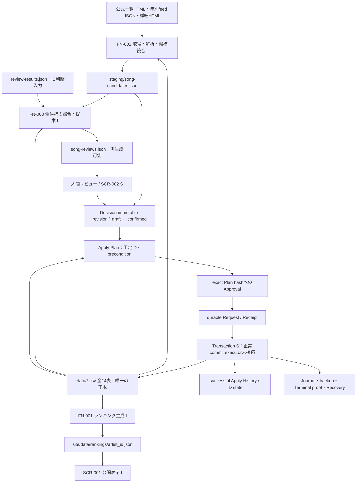

# データライフサイクルとSCR-002への調査結果

調査main：`4a2bb71944121b44d340b8c4bd4244b3ad3b7f4f`（2026-11-04）。[一覧・区分・保存先](data-inventory.md)、[CRUD](crud-matrix.md)と併読する。I＝main実装、S＝正式設計（未接続を含む）、?＝未確定。既存の正式設計を変更する提案書ではない。

## 全体フロー

実装済みの収集→review派生、canonical→公開表示の間に、FN-004/SCR-002の設計済み・段階実装部分がある。図全体が自動実行できる意味ではない。Decision/Plan/Approval/Request受付はCSVを書き換えない。公開JSON生成はcanonical反映後の別操作で、Git commit/push/PRも通常運用の別段階。

## 各段階の入出力・保持・再実行・失敗

| 段階 | 入力→出力・保存場所 | 保持・再実行 | エラー/中断（確認できた範囲） |
| --- | --- | --- | --- |
| FN-002 I | 公式HTML/feed、songs/works、既存D02→D02候補＋D06summary | source位置IDでmerge。status/notes/detected_at/confirmed ID維持、facts/last_seen_at再取得更新。消えた観測も候補から自動削除しない | 選択全artistの取得・解析成功後だけtemp→renameで一括保存。detail一部失敗でも全staging更新中止。15秒timeout等。fsync・複数file journal保証はない |
| FN-003 I | D02＋全14canonical＋任意D04→D03 reviews | 全候補を再照合して全file置換。holdを含め再計算。source snapshot・仮ID・候補提示は確定判断ではない | JSON/schema/ID重複・canonical欠落等は全体STOP、既存出力維持。candidate固有不足はblockedとして出力。自分のtempは保存例外時除去 |
| 人間判断/FN-004 I部品、SCR-002 S | candidate/source→F01 decisions.json | draft保存、confirmed/cancelledもimmutable新revision。head token/OCC、source fingerprint、aggregate scopeを保持。旧結果は明示取込・再確認が必要 | source facts変更・OCC競合・identity不足等は確定不可。古いtabの自動mergeをしない(S) |
| Plan I | 有効confirmed、canonical/state/History等→F02 | immutable payloadをhash。予定IDを予約しない。同payloadは既存Plan、新preconditionは新Plan | stale/unsupported/History不整合を再検証。Plan生成とApplyを暗黙連結しない |
| Approval/Request I受付、後続S | exact Plan/hashの人間確認→F03、F05 | Approvalはimmutable、永久失効F04を別追記。Request IDとpayloadを固定、同ID同payloadは再実行でなく照会 | 同ID異payload/conflictはSTOP。受付後通信断は失敗と断定せず照会。現mainの受付はexecutorへ未接続、Request存在だけでruntimeをblockし得る |
| Transaction S、prepare/失敗側I | F01〜F05とbefore全14表→tx配下journal/backup/target、canonical、state | 共通gate。全14表byte snapshotのbackup、固定apply_time、限定9表のtarget。commit開始時ID消費、失敗復元でも上限を下げない | COMMIT_DECIDED前は原則abort/rollback、後は元成功方針のforward finalize。未知bytes/不整合/所有権不明はmanual STOP。正常commit executor完成とは扱わない |
| 成功/終端証跡 I検証・失敗側、正常publication S | 元tx証跡→F07成功History、F23proof、F06completion、F08state | 成功Historyのhash chain/set/state証明。no_opだけでも成功経路を通す設計。成功時刻・元recordを再利用 | committedとreadinessを分離。成功後finalization/cleanup待ちを単純失敗や再Applyへ変換しない。失敗proofは成功Historyではない |
| cleanup/recovery I内部部品・S接続 | fresh観測・元gate/owner・journal/backup→復元/終端/retirement | 未完了証跡を保持。archiveとproofはv1 GCなし。temp/backupは検証済み終端・所有権・durability確認後に限定cleanup | PID不存在/経過時間だけでlock削除不可。別hostや不十分な根拠はSTOP。fresh cloneにarchiveがないことから旧Recoveryを自動再開しない |
| FN-001 I | 集計6表（gate検証は全表も参照）→D05 | artist_id別JSONを再生成。同じcanonicalから再集計。生成物を正本へ逆反映しない | 読込/gate/集計失敗はthrow。generatorは最終fileへ直接writeFileし、FN-003と同じatomic保存保証はない |
| SCR-001 I | D05→ブラウザ表示 | fetchした生成JSONから表示。永続canonical/レビュー状態は変更しない | 公開前のtest/検証/build/生成物差分検査はPages workflow。管理データを公開JSONへ含める仕様はない |

根拠：[collector](../src/collector/collect.js)、[merge](../src/collector/merge-candidates.js)、[prepare](../src/prepare-reviews.js)、[Decision](design/FN-004-判断モデル.md)、[Plan](design/FN-004-反映計画.md)、[Approval/Request](design/FN-004-承認・反映リクエスト.md)、[Transaction/Recovery](design/FN-004-反映処理・復旧.md)、[History](design/FN-004-成功履歴・読取検証.md)、[generator](../scripts/generate-rankings.js)、[workflow](../.github/workflows/deploy-pages.yml)。

## FN-002の再収集防止

**確認結果：永続的な再検索スキップではなく、再取得後の候補重複防止が実装されている。**

1. 永続保存はD02 `staging/song-candidates.json`。独立した「検索済みURL一覧」「収集cursor」「ETag等の永続cache」はcollect/merge実装では確認できない。
2. 毎回対象artistの一覧、feed年、release詳細を取得する。feed URLごとのMapは同じcollectCandidates実行内の共有cacheで、終了すると失われる。前回承認済みかどうかをHTTP取得省略条件にしない。
3. candidate_idはsource artist slug、正規化release URL、media type、edition、product number/null、disc index、track numberのsource位置からhash生成する。titleを現行IDに含めず、既知legacy IDの移行処理もある。タイトル一致はcanonical登録確定ではない。
4. 再発見時にfacts/match候補を更新し、旧status/notes/detected_at、確認済みsong/work IDを保持してlast_seen_at更新。選択範囲外や再発見されない候補もbyIdに残る。承認状態だけで候補を除外しない。
5. 「承認後も検索済み情報が保持されるか」への回答は、独立台帳はなく、候補内の収集情報を保持するmerge実装がある、という範囲。FN-004後も専用台帳で再取得不要を保証する仕様ではない。

根拠：[collectArtist/collectCandidates](../src/collector/collect.js)、[candidateId/mergeCandidates](../src/collector/merge-candidates.js)、[FN-002設計](design/FN-002-楽曲候補収集.md)。全artist成功後のsaveなので、失敗した実行の部分的な「検索済み」進捗保存も行わない。

## FN-004反映後の候補データ

| 確認項目 | 結論・区分 |
| --- | --- |
| 承認候補を物理削除するか | FN-004の対象write pathにcandidate削除はない。v1設計はcandidateをsource factsとして参照し、別Historyを残す。mainの通常Apply完了処理は未接続なので実行実績を断定しない |
| statusをappliedへ変更して保持するか | 自動status更新仕様・writerは確認できない。candidate旧statusはcollectorが保持するが、正式なworkflow状態として採用しない |
| 履歴に別途保存するか | S：成功HistoryがDecision/Plan snapshot、candidate coverage、確定ID等を保持。I：History検証・lookup/構築部品。正常publicationは未接続。元candidate fileをHistory directoryへ移動する仕様ではない |
| 未承認候補は次回使えるか | I：collectorは旧候補を保持し、FN-003は全候補をレビューへ再生成。S：未適用scopeをDecisionとして判断可能。ただしsource facts変更、既存coverage、canonical/ID/History不整合は再検証が必要 |
| 反映済み判定の根拠 | I/S：完全検証済みHistoryのby_decision_revision/by_candidate/by_request/by_plan index。ALREADY_APPLIEDやAPPLIED_CANDIDATE_COVERAGE_UNSUPPORTED等を返す。candidate.statusやlegacy applied_resultだけでは不可 |

根拠：[v1 scope/legacy分離](design/レビュー準備・canonical反映の全体フロー.md)、[限定write対象](../src/fn004-evidence-types.js)、[History indexesとlookup](../src/fn004-history-projections.js)、[完全runtime検証](../src/fn004-history-runtime.js)、[collector merge](../src/collector/merge-candidates.js)。

「Candidate全体の最終status管理」や「承認後の整理削除」をここで追加定義しない。適用済み訂正も既存成功を再Applyする操作ではなく、v1 canonical correction対象外という制約を維持する。

## SCR-002での表示可否と設計上の論点

| 検討表示 | 既存データから分かること | 境界・追加確認 |
| --- | --- | --- |
| 未承認の登録候補一覧 | I：candidate/reviewがあり、S：candidate・draft・有効confirmed・Plan・Historyから状態を導出する一覧契約がある | 「未承認」が未判断/未confirmed/未Approval/未Applyのどれかを区別する必要。新しい共通statusを追加する設計ではない。FN-003の正式Decision/History表示adapterは未確定 |
| 複数チェックボックスで一括承認 | S：Decision aggregateはcandidate ID集合をscopeにできる | 既存aggregate部分適用はv1対象外。選択集合のaggregate設計、共有entity、prefix、OCC、Plan hashごとの明示確認が必要。複数独立Decision/Planを一回で承認するbatch API/原子性/部分失敗仕様は未確認。チェック操作だけで個別candidateを確定できるとは言えない |
| FN-004後の承認済み・反映済み確認 | S：Approval/Invalidation/Request/History/stateのtrace。I：読み取り・検証部品 | Approval済みと成功済みは別。COMMITTED_PENDING_FINALIZATION、cleanup_required、unknown_result等を区別。raw JSONの存在だけで成功・readinessを断定しない |
| Git未反映のローカルcanonical変更 | 実fileとGit履歴/index/working tree差分から調査可能。S：Apply結果の変更CSV・確定ID・Git diff確認を規定 | 現在の公開JSONだけでは不可。未commit、commit済み未push、main未mergeを区別する必要。専用差分取得APIは未確認。FN-004 Git auditはID監査で、画面向け差分APIと同一ではない。手動変更/他作業分を特定txの結果と自動断定しない |

正式SCR-002は管理一覧、レビュー編集、Decision確認、Apply Preflight、Apply結果、System Statusの6内部view。認証済み管理者backendを介し、browserからfilesystem/Gitへ直接書かない。provider/hostingは未選定。bootstrap/recovery実行はCLIのみ。これらの既存境界に従って表示材料と不足部分を整理したもので、新UI/APIを本タスクで設計・実装していない。

根拠：[SCR-002 views・workflow / traceability・Git](design/楽曲管理のCLI・画面連携.md)、[Decision scope](design/FN-004-判断モデル.md)、[Git audit](../src/fn004-git-audit.js)、[History証明](design/FN-004-成功履歴・読取検証.md)。

## 未確定事項・次回確認

- 正常commit executor、History publication、成功後finalization/cleanup、CLI/backend/frontendの接続はmain実装範囲を再確認する必要がある。今回のI/S境界は固定SHA時点であり、将来merge後に更新する。
- candidateのApply後status自動変更・削除/archival、一般保持期限/GC、再収集スキップ台帳は仕様として確定していない。本書では新設しない。
- legacy review-resultsのwriter・正式Decisionへの明示取込手順、SCR-002向けFN-003 adapter・認証/hosting/APIは要確認。
- 一括承認の選択単位、既存aggregateと選択候補の整合、複数Planの承認単位・失敗時の表示は別途設計判断が必要。
- Git差分表示の比較対象（HEAD/index/origin/main等）、未push検出、履歴結果とローカル変更の対応づけは追加調査が必要。
- common gateでreaderは協調する一方、collector保存は単一JSON temp/renameで、FN-004完全Transaction保証と同一ではない。並行収集・candidate変更とApply前fingerprint再検証の接続は今後の実装確認対象。
- Git非管理でもdurableなRequest/journal/backupが必要。fresh cloneでruntime-local Recovery証跡が欠けた場合の自動再開を保証しない。設計上の非管理方針と現行ignoreの網羅性も別問題。

この調査ではアプリ・テスト・CSV・生成JSON・workflow・既存正式仕様を変更せず、実データ収集/Apply/生成も実行しない。文書内リンク・表の51 ID対応・変更path限定を確認して提出する。
