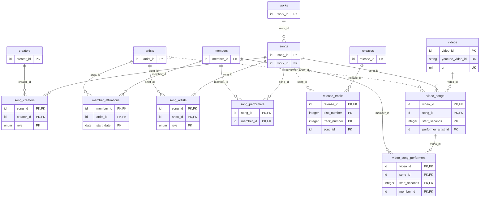

# データ仕様 v0.3

> 2026-11-25 運用切替：14表のschema・業務ルールは不変です。現行採番はdata/id-high-water.json（全namespace、単調増加）と最新mainとの差分検証を使用します。下記FN-004のapply_time等の説明は保存版に限り、CSV直接編集では出典と実際の登録/更新日時を記載します。

## 1. 基本方針

`data/` 以下の UTF-8 CSV（RFC 4180 準拠、ヘッダーあり）を正本とする。1 レコードは論理上の 1 レコードとする。カンマ・改行・ダブルクォートを含む値はダブルクォートで囲み、内部のダブルクォートは二重化する。引用内の改行は値の一部として保持する（D2）。列順は本書および各 CSV のヘッダー順に固定する。

本書はcanonical全体の仕様・一般運用を定義する。[FN-004 v1設計](../system/レビュー準備・canonical反映の全体フロー.md)の自動反映範囲は既存参照と新規row追加に限定し、本書で一般的に許容する初出日訂正・version見直し等のexisting field update/deleteを実行する機能ではない。CSV列・enum・ID規則は今回変更しない。Decision/Plan/Approval/Request/Historyはcanonicalと区別する。

### work、song、release

- **work** は「楽曲という作品」そのもの。同一の詞・曲を基礎とする関連版を束ねる。
- **song** は、その作品の具体的な音源・歌唱 Version。登録基準はシングル曲かアルバム曲かではなく、その具体的な音源が既に `songs.csv` に存在するかである。
- **release** は、シングル、アルバム、公式配信等のリリース商品・作品。song の収録先は `release_tracks.csv` で表す。
- 同一音源のアルバム等への再収録では新しい `song_id` を作らず、同じ song を複数の release に紐付ける。New Vocal Ver.、新録・再録、別歌唱者によるカバー、公式に別 Version とされた音源は別 song とし、同じ作品なら `work_id` を共有する。
- Instrumental、MV、Dance Shot 等は song として登録しない。ライブの短縮版、メドレー、ライブ固有アレンジ、一時的な歌唱者変更も、公式に別音源・別 Version としてリリースされない限り新しい song にしない。映像ごとの歌唱者は `video_song_performers.csv` で表す。

### 同一音源の判定と収集順序

収集は発売順でなくてよい。例えばアルバム `terzo` を先に調査し、収録されたシングル既出曲がまだ `songs.csv` にない場合は、その song を登録してよい。後からシングルを調査して同一音源と確認できた場合、新しい song は作らず、既存 `song_id` を維持したまま、その音源の実際の初出日に `songs.release_date` を更新し、必要なら `version_type` も公式情報に基づく正しい値へ更新する。過去の release は `releases.csv` に追加し、`release_tracks.csv` から既存 song に紐付ける。

同じ具体的な音源・歌唱 Version が後から別のシングル、アルバム、ベスト盤等へ再収録されても、「別の商品に収録された」ことだけを理由に song を増やさない。各収録関係を `release_tracks.csv` に追加し、すべて同じ `song_id` を使用する。反対に、同じ work でも New Vocal Ver.（`new_vocal`）、明確な新録・再録（`re_recording`）、別歌唱者によるカバー（`cover`）、その他の公式な別 Version（`other`）は、同じ `work_id` を共有する別 song とする。公式表記だけでは再録と確定できない場合は `other` とし、後から公式情報を確認できた時点で `re_recording` への更新を検討する。

登録時に見るのは「過去にシングル発売されたか」だけではなく「現在の `songs.csv` に同一音源が登録済みか」である。後から過去の release が見つかった場合も、まず同じ音源か別 Version かを確認する。同一音源なら上記のとおり既存 song を更新・再利用し、別音源であると確認できた場合に限り別 `song_id` を採番する。

同一性に確証がないときは、既存 song への統合も新規 `song_id` の採番も推測で行わず、**要確認として保留しユーザー判断を求める**。特に次は自動判断しない。

- 同名だが歌唱メンバーが異なる
- アルバム収録時に新録された可能性がある
- Version 表記が曖昧
- クレジットは同じだが音源が同一か分からない
- 表記違いだが同一 Version の可能性がある

今後のデータ収集でも、Codex は一次情報から確証を持てない同一性判定を勝手に行わない。

#### アルバム等への無印再収録の audio identity 判定

同一 work の既発 song が後発のアルバム、ベスト盤その他の release に無印で再収録され、(1) 別 Version
表記がない、(2) artist credit に別録音を示す差がない、(3) creator credit に別 Version を示す差がない、
(4) New Vocal、re-recording、Album Ver. 等の別録音を示す公式情報がない、かつ (5) その他に別 audio と
判断すべき積極的な根拠がない場合は、**原則として既存 song の再収録**として扱う。新しい `song_id` は
作成せず、`release_tracks.csv` から既存 `song_id` を再利用する。

これは「Version 表記がなければ必ず同一 audio」という絶対ルールではない。無印であることは判断材料の
一つにすぎない。New Vocal、re-recording、Album Ver.、Memorial Edit、Remixその他の明示された別
Version、creator／arrangement の変更、別録音を示す performer の変更、公式な再録明記、その他の
一次情報など、別 audio を示す積極的根拠がある場合は既存 song を自動再利用しない。同一作品の別音源なら
既存 work + 新規 song、作品自体も異なる場合は必要に応じて別 work + song として判断する。

公式一次情報を最優先し、title、Version 表記、artist、creator、performer、公式リリース時系列、duration、
公式 release 情報を総合して合理的に判定する。公式に「同一 master」と明記されていないことだけを理由に
永久に判断不能とはしない。一方、Spotify 等の第三者 metadata だけで同一／別 audio を確定しない。
ユーザー自身が音源比較等を行い明示的に判断した場合は、根拠とともに user-confirmed decision として
research に記録できる。この一般ルールを適用しても重大な不確実性が残る場合は、推測で統合せず従来どおり
ユーザー確認で停止する。

duration は audio identity の**補助情報**であり、単独の決定条件ではない。duration の一致だけで同一
audio を確定せず、差だけで別 audio を確定しない。数秒程度の差は metadata の丸め、track boundary、
先頭・末尾の無音、mastering、source ごとの計測方法でも生じ得るため、特に小さな差だけを理由に新規 song
を作成しない。ただし「1秒以内なら必ず同一 audio」などの固定閾値も設けず、他の根拠と合わせて判断する。

ユーザー判断が必要な事項を提示するときは、対象、一次情報から確認できた事実、判断できない理由、選択肢、登録の停止点に加え、判断に用いた一次情報 URL を必ず併記する。複数の一次情報を用いた場合は、関連する URL をすべて提示する。

### 一次情報

楽曲データの一次情報は原則として Hello! Project 公式サイトとし、主に公式リリース情報から曲名、発売日、作詞、作曲、編曲、歌唱者、Version 表記、収録商品を取得する。公式情報が複数ある場合は、楽曲・release を直接説明する情報を優先する。第三者サイトを一次情報として扱わず、公式サイトだけで確認できない値は推測で補完せず要確認とする。

### 共通表記、NULL、日時

- ID、列挙値、URL、日付、時刻秒は半角 ASCII、名称・注記は公式表記を原則とする。
- 必須列は空欄不可。任意列の不明・該当なしは空欄とし、`NULL`、`N/A`、`-` 等を入れない。
- 日付は完全に確認できる場合のみ `YYYY-MM-DD` で記録し、年月・年しか分からない値を補完しない。
- 日時はタイムゾーンを含む ISO 8601（例 `2026-09-24T22:15:00+09:00`）とする。
- 真偽値は `true` / `false` とする。
- `source_url` は当該行を裏付ける一次情報の絶対 HTTPS URL。現時点で `source_checked_at` は追加しない。複数出典や確認日を厳密に管理する必要が生じた場合は `sources.csv`、`record_sources.csv` 等を検討する。

マスタ系 CSV（works、songs、creators、artists、members、videos、releases）の `created_at` は正本データへ最初に登録した日時、`updated_at` はそのレコード自体を最後に更新した日時であり、発売日や公式情報公開日ではない。新規作成時は原則同値とし、更新時は `created_at` を変えず `updated_at` のみ更新する。関連テーブル（song_creators、member_affiliations、song_artists、song_performers、release_tracks、video_songs、video_song_performers）には現時点で両列を設けず、詳細な変更履歴は Git で追跡する。

`created_at` / `updated_at` は登録・更新時期を簡単に参照するための情報である。Git は誰が、どのコミットで、何をどのように変更したかを追跡する完全な変更履歴であり、CSV 内に更新履歴自体を複数行・複数列で蓄積しない。

### ID 採番

| 対象 | 形式 | 例 | 方針 |
|---|---|---|---|
| work | `W` + 5 桁連番 | `W00001` | 作品単位で全体一意 |
| creator | `C` + 5 桁連番 | `C00001` | 同一人物・同一制作主体を識別 |
| member | `P` + 5 桁連番 | `P00001` | 人物を識別 |
| artist | `G` + 5 桁連番 | `G00001` | 活動主体を識別 |
| release | `L` + 5 桁連番 | `L00001` | リリース商品・作品単位で一意 |
| video | `V` + 5 桁連番 | `V00001` | YouTube 動画単位で一意 |
| song | 接頭辞 + 5 桁連番 | `J00001` | 主な歌唱側の系列内で一意 |

song 接頭辞は `M`（モーニング娘。）、`A`（アンジュルム）、`J`（Juice=Juice）、`T`（つばきファクトリー）、`B`（BEYOOOOONDS）、`O`（OCHA NORMA）、`R`（ロージークロニクル）、`H`（Hello! Project 全体、企画曲、通常グループに属さないケース）とする。カバーはカバー側を使う。GOODM!X 等の特殊／シャッフルユニット、在籍中メンバーのソロ名義等で通常グループに該当しないものは原則 `H` とし、実際の名義・人物は artists、song_artists、song_performers で表す。採番済み ID は再利用せず欠番を許容する。

ID は永続的な識別子であり、発売順・時系列を表さない。例えば `J00001` は Juice=Juice 系列で最初に採番された song であって、最古に発売された song であることを意味しない。後から過去の song を追加しても既存 ID は振り直さず、発売順の判断には `songs.release_date` と releases / release_tracks の情報を使用する。

### 参照整合性、変更、削除

- PK は一意かつ空欄不可、FK は参照先に存在すること。複合 PK の全列の組み合わせを一意とする。
- 表示順を持つ関連表では、同じ親・文脈における順序値も一意とする。
- 表記訂正は ID を保って更新する。同一性が変わる場合のみ新 ID を採番する。
- 参照中の行を物理削除しない。誤登録は同じ変更で関連行を修正・削除し、履歴は Git で追跡する。FK の連鎖削除は行わない。
- [canonical validator](../../../src/canonical-validator.js) は全14テーブルを対象に、重複PK、FK参照、列挙値、ID・日付・日時形式等を検証する。FN-004の検証済みsnapshotはこの検証を通す。
- FN-001の[ランキング用reader](../../../src/canonical.js)が読み込むのは `artists`、`creators`、`songs`、`works`、`song_artists`、`song_creators` の6テーブル。ランキング用の読み込み範囲と全14テーブルのcanonical validationは別の責務。

関連テーブルに対象行がないことは、関係が存在しないことだけでなく、未調査・未確認のため構造化データがまだ登録されていないことも意味し得る。特に `song_performers` と `video_song_performers` では、行の不在を「該当なし」と断定しない。現時点では status 列を追加せず、将来「該当なし」と「未確認」の機械的な区別が必要になった場合に、status 列または調査状態管理の導入を検討する。

## 2. CSV一覧

canonical は全14テーブル・106列。列数にヘッダーの各項目を1回ずつ数える。

| ファイル・パス | 論理名 | 概要・用途 | 列数 | PK | 個別定義 |
| --- | --- | --- | --- | --- | --- |
| `data/works.csv` | 楽曲作品 | 同一作品の音源を束ねる | 7 | `work_id` | [個別定義](#dataworkscsv) |
| `data/songs.csv` | 楽曲音源 | 具体的な音源・歌唱Version | 10 | `song_id` | [個別定義](#datasongscsv) |
| `data/creators.csv` | 作家・制作主体 | 制作クレジットの主体 | 7 | `creator_id` | [個別定義](#datacreatorscsv) |
| `data/song_creators.csv` | 制作クレジット | 音源ごとの作家・担当・掲載名義 | 6 | `song_id, creator_id, role` | [個別定義](#datasong_creatorscsv) |
| `data/artists.csv` | アーティスト | グループ・ソロ等の活動主体 | 9 | `artist_id` | [個別定義](#dataartistscsv) |
| `data/members.csv` | メンバー | 個人の識別 | 8 | `member_id` | [個別定義](#datamemberscsv) |
| `data/member_affiliations.csv` | 所属履歴 | 個人と活動主体の所属期間 | 6 | `member_id, artist_id, start_date` | [個別定義](#datamember_affiliationscsv) |
| `data/song_artists.csv` | アーティスト名義 | 主名義・客演の公式掲載順 | 5 | `song_id, artist_id, role` | [個別定義](#datasong_artistscsv) |
| `data/song_performers.csv` | 音源歌唱者 | 標準音源の個人歌唱者 | 5 | `song_id, member_id` | [個別定義](#datasong_performerscsv) |
| `data/releases.csv` | リリース | 商品・公式配信 | 9 | `release_id` | [個別定義](#datareleasescsv) |
| `data/release_tracks.csv` | 収録曲 | 商品内の位置と音源 | 7 | `release_id, disc_number, track_number` | [個別定義](#datarelease_trackscsv) |
| `data/videos.csv` | 公式動画 | YouTube動画と公開情報 | 11 | `video_id` | [個別定義](#datavideoscsv) |
| `data/video_songs.csv` | 動画内楽曲区間 | 動画内の音源・開始秒・歌唱名義 | 9 | `video_id, song_id, start_seconds` | [個別定義](#datavideo_songscsv) |
| `data/video_song_performers.csv` | 動画区間歌唱者 | 区間の個人歌唱者 | 7 | `video_id, song_id, start_seconds, member_id` | [個別定義](#datavideo_song_performerscsv) |

## 3. 論理ER図

図にはキー属性を掲載する。実線は参照元FKがPKを構成する関係、破線はその他の関係を示す。複合PKの列順は個別定義、複合FKの列対応は関係表を参照する。

### FK関係表

多重度は「親1行あたりの子」「子1行あたりの親」の順。

| 参照元（子） | 参照先（親） | 子の件数 | 親の件数 | 関係の役割 |
| --- | --- | --- | --- | --- |
| `songs.work_id` | `works.work_id` | 0..N | 1 | 楽曲音源 |
| `song_creators.song_id` | `songs.song_id` | 0..N | 1 | 制作クレジット |
| `song_creators.creator_id` | `creators.creator_id` | 0..N | 1 | 制作クレジット |
| `member_affiliations.member_id` | `members.member_id` | 0..N | 1 | 所属履歴 |
| `member_affiliations.artist_id` | `artists.artist_id` | 0..N | 1 | 所属履歴 |
| `song_artists.song_id` | `songs.song_id` | 1..N | 1 | アーティスト名義（primaryが1件以上） |
| `song_artists.artist_id` | `artists.artist_id` | 0..N | 1 | アーティスト名義 |
| `song_performers.song_id` | `songs.song_id` | 0..N | 1 | 音源歌唱者 |
| `song_performers.member_id` | `members.member_id` | 0..N | 1 | 音源歌唱者 |
| `release_tracks.release_id` | `releases.release_id` | 0..N | 1 | 収録曲 |
| `release_tracks.song_id` | `songs.song_id` | 0..N | 1 | 収録曲 |
| `video_songs.video_id` | `videos.video_id` | 0..N | 1 | 動画内楽曲区間 |
| `video_songs.song_id` | `songs.song_id` | 0..N | 1 | 動画内楽曲区間 |
| `video_songs.performer_artist_id` | `artists.artist_id` | 0..N | 0..1 | 動画内楽曲区間 |
| `video_song_performers.(video_id, song_id, start_seconds)` | `video_songs.(video_id, song_id, start_seconds)` | 0..N | 1 | 動画区間歌唱者 |
| `video_song_performers.member_id` | `members.member_id` | 0..N | 1 | 動画区間歌唱者 |

作家・アーティスト・歌唱者・所属先・リリース・動画との多対多は、図中の関連テーブルで表す。同じ動画の区間は `(video_id, song_id, start_seconds)` で識別し、区間歌唱者からの3列は1本の複合FKとして検査する。固定の1対1関係はない。

各songには少なくとも1件の `primary` が必要。動画区間は構造化された歌唱artistを空欄にできるが、歌唱名義の `performer_credit` は必須。歌唱者や所属の行が0件でも未調査の場合がある。掲載順と所属期間の制約は[列挙値・制約一覧](#5-列挙値制約一覧)を参照する。

## 4. CSV個別定義

CSVセルの保存表現は文字列。表の型、PK、FK、一意性は論理上の定義で、機械検証の適用範囲は[列挙値・制約一覧](#5-列挙値制約一覧)を参照する。「任意」はセルが空欄可という意味で、ヘッダー列の省略は不可。桁数は文字数で表す。「未規定」は仕様上の長さ上限がない箇所、「—」は該当なしを示す。「実値」は現行CSVから採った列ごとの独立した例、「例」は説明用で、同一行や実在する組み合わせを示すものではない。

以下で「日付」は `YYYY-MM-DD`、「日時」はタイムゾーン付き ISO 8601、「URL」は絶対 HTTPS URL、「正整数」は 1 以上、「非負整数」は 0 以上を表す。

### `data/works.csv`

| カラム名 | 論理名 | 論理型 | 桁数・最大長 | 必須・空欄 | PK / FK | FK参照先 | 一意制約 | 許容値・形式 | 初期値・デフォルト | 項目説明・備考 | サンプル値 |
| --- | --- | --- | --- | --- | --- | --- | --- | --- | --- | --- | --- |
| `work_id` | 作品ID | ID | 6文字 | 必須・空欄不可 | PK | — | 単独PK | `^W[0-9]{5}$` | 自動設定なし | PK、`^W[0-9]{5}$` | 実値 `W00001` |
| `title` | タイトル | 文字列 | 未規定 | 必須・空欄不可 | — | — | — | 公式表記・自由記述（項目による） | 自動設定なし | 作品の代表タイトル | 実値 `微炭酸` |
| `title_kana` | タイトル読み | 文字列 | 未規定 | 任意・未設定は空欄 | — | — | — | 公式表記・自由記述（項目による） | 自動設定なし | 検索用の読み | 実値 空欄 |
| `notes` | 注記 | 文字列 | 未規定 | 任意・未設定は空欄 | — | — | — | 公式表記・自由記述（項目による） | 自動設定なし | 同一作品判定等 | 実値 `ユーザー確認によりカバー作品として確定。原曲songは今回未登録。` |
| `source_url` | 出典URL | URL | 未規定 | 必須・空欄不可 | — | — | — | 絶対 HTTPS URL | 自動設定なし | 作品名の一次情報 | 実値 `https://helloproject.com/release/detail/HKCN-50580/?pc=1` |
| `created_at` | 登録日時 | 日時 | 未規定 | 必須・空欄不可 | — | — | — | タイムゾーン付き ISO 8601 | CSV既定値なし。FN-004の新規行は対象に応じて apply_time を設定 | 正本への初回登録日時 | 実値 `2026-09-25T07:31:25+00:00` |
| `updated_at` | 更新日時 | 日時 | 未規定 | 必須・空欄不可 | — | — | — | タイムゾーン付き ISO 8601 | CSV既定値なし。FN-004の新規行は対象に応じて apply_time を設定 | レコードの最終更新日時 | 実値 `2026-09-26T16:43:46+00:00` |

- **主キー** `(work_id)`

### `data/songs.csv`

| カラム名 | 論理名 | 論理型 | 桁数・最大長 | 必須・空欄 | PK / FK | FK参照先 | 一意制約 | 許容値・形式 | 初期値・デフォルト | 項目説明・備考 | サンプル値 |
| --- | --- | --- | --- | --- | --- | --- | --- | --- | --- | --- | --- |
| `song_id` | 音源ID | ID | 6文字 | 必須・空欄不可 | PK | — | 単独PK | `^[MAJTBORH][0-9]{5}$` | 自動設定なし | PK、`^[MAJTBORH][0-9]{5}$` | 実値 `J00001` |
| `work_id` | 作品ID | ID | 6文字 | 必須・空欄不可 | FK | `works.work_id` | — | `^W[0-9]{5}$` | 自動設定なし | FK → `works.work_id` | 実値 `W00001` |
| `title` | タイトル | 文字列 | 未規定 | 必須・空欄不可 | — | — | — | 公式表記・自由記述（項目による） | 自動設定なし | この版の公式曲名 | 実値 `微炭酸` |
| `version_name` | バージョン名 | 文字列 | 未規定 | 任意・未設定は空欄 | — | — | — | 公式表記・自由記述（項目による） | 自動設定なし | Version 名。なければ空欄 | 実値 `New Vocal Ver.` |
| `version_type` | バージョン種別 | 列挙 | 未規定 | 必須・空欄不可 | — | — | — | [列挙値一覧](#5-列挙値制約一覧) | 自動設定なし | `original`, `new_vocal`, `re_recording`, `cover`, `other` | 実値 `original` |
| `release_date` | リリース日 | 日付 | 10文字 | 任意・未設定は空欄 | — | — | — | `YYYY-MM-DD` | 自動設定なし | この具体的音源が公式商品または公式配信で最初にリリースされた日 | 実値 `2019-02-13` |
| `notes` | 注記 | 文字列 | 未規定 | 任意・未設定は空欄 | — | — | — | 公式表記・自由記述（項目による） | 自動設定なし | 版の判定等 | 実値 `2019-02-13「微炭酸／ポツリと／Good bye & Good luck！」収録音源とterzo収録音源を同一音源として扱う（ユーザー確定判断）。` |
| `source_url` | 出典URL | URL | 未規定 | 必須・空欄不可 | — | — | — | 絶対 HTTPS URL | 自動設定なし | 曲名・版の一次情報 | 実値 `https://helloproject.com/release/detail/HKCN-50580/?pc=1` |
| `created_at` | 登録日時 | 日時 | 未規定 | 必須・空欄不可 | — | — | — | タイムゾーン付き ISO 8601 | CSV既定値なし。FN-004の新規行は対象に応じて apply_time を設定 | 正本への初回登録日時 | 実値 `2026-09-25T07:31:25+00:00` |
| `updated_at` | 更新日時 | 日時 | 未規定 | 必須・空欄不可 | — | — | — | タイムゾーン付き ISO 8601 | CSV既定値なし。FN-004の新規行は対象に応じて apply_time を設定 | レコードの最終更新日時 | 実値 `2026-09-26T16:43:46+00:00` |

- **主キー** `(song_id)`

`release_date` は CD と公式配信で異なる場合、原則として、その具体的音源の公式な full audio（フル音源）が最初に商用リリースまたは配信された日とし、CD 発売前の公式 full audio 配信も採用する。着うた等の partial audio（部分音源）だけが先行配信された日は採用せず、ライブ初披露日も含めない。「先行配信を確認できない」ことを「先行配信が存在しない」こととは扱わず、確認できた最初の full audio リリース日を記録する。個別の CD 発売日、配信日、アルバム再収録日、その他の商品収録は releases / release_tracks で管理する。

#### `version_type=original` の定義と判定

`original` は、**その work について、公式情報から確認できる最初の通常の公式リリースとなる song** を意味する。「このプロジェクトの CSV へ最初に登録した song」という意味ではない。CSV への登録順、`song_id` の採番順、release を調査した順番は判定に使用せず、公式情報上のリリース時系列を基準とする。`original` は原則 1 work に 1 件だが、同時に異なる歌唱者で成立した例外は根拠を `notes` に記す。

判定には、その具体的な音源・歌唱 Version が公式商品または公式配信として最初にリリースされた日である `songs.release_date` と、公式の Version 情報を用いる。同一 work に複数の song がある場合も、CSV 上の順番ではなく、公式リリース時系列、Version 表記、カバーか、New Vocal／再録等かを合わせて判断する。したがって、同一 work 内で `release_date` が最古の song を機械的・無条件に `original` とするルールではない。

例えば Hello! Project 対象外の原曲が先に存在し、Juice=Juice がその work を後から歌唱した場合、Juice=Juice 版しかこのリポジトリに登録されていなくても、その song は `cover` であって `original` ではない。リポジトリへの登録有無や対象範囲は作品上の原曲・カバー関係を変えない。

後日の調査で、現在 `original` としている song より前に別の具体的 song が存在したと判明した場合は、公式情報に基づいて正しい song を追加または修正し、関係する `version_type` を見直す。ただし、過去の release が見つかっただけでは別 song を作らない。同一音源なら既存 `song_id` を使用して `release_date` と収録関係を更新し、別音源であると確認できた場合のみ別 song として登録する。

### `data/creators.csv`

| カラム名 | 論理名 | 論理型 | 桁数・最大長 | 必須・空欄 | PK / FK | FK参照先 | 一意制約 | 許容値・形式 | 初期値・デフォルト | 項目説明・備考 | サンプル値 |
| --- | --- | --- | --- | --- | --- | --- | --- | --- | --- | --- | --- |
| `creator_id` | 作家ID | ID | 6文字 | 必須・空欄不可 | PK | — | 単独PK | `^C[0-9]{5}$` | 自動設定なし | PK、`^C[0-9]{5}$` | 実値 `C00001` |
| `name` | 名称 | 文字列 | 未規定 | 必須・空欄不可 | — | — | — | 公式表記・自由記述（項目による） | 自動設定なし | 人物・制作主体を識別する代表名 | 実値 `山崎あおい` |
| `name_kana` | 名称読み | 文字列 | 未規定 | 任意・未設定は空欄 | — | — | — | 公式表記・自由記述（項目による） | 自動設定なし | 代表名の読み | 実値 空欄 |
| `notes` | 注記 | 文字列 | 未規定 | 任意・未設定は空欄 | — | — | — | 公式表記・自由記述（項目による） | 自動設定なし | 別名義等 | 実値 空欄 |
| `source_url` | 出典URL | URL | 未規定 | 任意・未設定は空欄 | — | — | — | 絶対 HTTPS URL | 自動設定なし | 同一性・名称の一次情報 | 実値 `https://helloproject.com/juicejuice/release/6692/` |
| `created_at` | 登録日時 | 日時 | 未規定 | 必須・空欄不可 | — | — | — | タイムゾーン付き ISO 8601 | CSV既定値なし。FN-004の新規行は対象に応じて apply_time を設定 | 正本への初回登録日時 | 実値 `2026-09-25T07:31:25+00:00` |
| `updated_at` | 更新日時 | 日時 | 未規定 | 必須・空欄不可 | — | — | — | タイムゾーン付き ISO 8601 | CSV既定値なし。FN-004の新規行は対象に応じて apply_time を設定 | レコードの最終更新日時 | 実値 `2026-09-25T07:31:25+00:00` |

- **主キー** `(creator_id)`

`creator_id` はクレジット名義でなく、原則として同一人物・同一制作主体を識別する。同一人物による複数名義と確認できれば同じ ID を用い、曲ごとの実際の名義は `song_creators.credit_name` に残す。確証がない名義は推測で統合せず、別 ID とするか要確認として保留する。集計は `creator_id` を用いる。より厳密な名義履歴が必要なら `creator_aliases` 等を追加できる。

### `data/song_creators.csv`

| カラム名 | 論理名 | 論理型 | 桁数・最大長 | 必須・空欄 | PK / FK | FK参照先 | 一意制約 | 許容値・形式 | 初期値・デフォルト | 項目説明・備考 | サンプル値 |
| --- | --- | --- | --- | --- | --- | --- | --- | --- | --- | --- | --- |
| `song_id` | 音源ID | ID | 6文字 | 必須・空欄不可 | PK / FK | `songs.song_id` | 複合PKの構成列、担当別掲載順の構成列 | `^[MAJTBORH][0-9]{5}$` | 自動設定なし | 複合 PK、FK → `songs.song_id` | 実値 `J00001` |
| `creator_id` | 作家ID | ID | 6文字 | 必須・空欄不可 | PK / FK | `creators.creator_id` | 複合PKの構成列 | `^C[0-9]{5}$` | 自動設定なし | 複合 PK、FK → `creators.creator_id` | 実値 `C00001` |
| `role` | 役割 | 列挙 | 未規定 | 必須・空欄不可 | PK | — | 複合PKの構成列、担当別掲載順の構成列 | [列挙値一覧](#5-列挙値制約一覧) | 自動設定なし | 複合 PK、`lyrics`, `english_lyrics`, `composition`, `arrangement`, `brass_arrangement` | 実値 `lyrics` |
| `credit_name` | 掲載名義 | 文字列 | 未規定 | 必須・空欄不可 | — | — | — | 公式表記・自由記述（項目による） | 自動設定なし | その song で実際に表示されたクレジット名義 | 実値 `山崎あおい` |
| `credit_order` | 掲載順 | 正整数 | 未規定 | 任意・未設定は空欄 | — | — | 担当別掲載順の構成列 | ASCII数字、1以上 | 自動設定なし | 同一 song・role 内の公式掲載順 | 実値 `1` |
| `source_url` | 出典URL | URL | 未規定 | 必須・空欄不可 | — | — | — | 絶対 HTTPS URL | 自動設定なし | クレジットの一次情報 | 実値 `https://helloproject.com/release/detail/HKCN-50580/?pc=1` |

- **主キー** `(song_id, creator_id, role)`
- **担当別掲載順の一意制約** `(song_id, role, credit_order)`。順序値が空欄の行は重複可。

共同担当は作家ごとに 1 行とする。集計では持分按分せず、各 `creator_id` を role ごとに 1 曲と数える。Web 等で当時の正式名義を表示するときは `credit_name` を用いる。

`english_lyrics` は、公式クレジットで「英語詞」等と明示された担当者に使用し、通常の`lyrics`とは別のrelationとして保持する。元の作詞者の`lyrics`を置換せず、英語詞担当者を通常の作詞者として扱わない。通常の作詞ランキングは`role=lyrics`のみを対象とし、`english_lyrics`を自動的に含めない。将来必要になった場合は、英語詞担当検索や英語詞ランキングとして独立集計できる。

`brass_arrangement` は、公式クレジットで「ブラスアレンジ」「Brass Arrangement」等と明示された作家に使用し、通常の「編曲」を表す `arrangement` とは別の relation として保持する。例えば公式表記が「編曲：A、ブラスアレンジ：B」であれば、A を `arrangement`、B を `brass_arrangement` として登録し、B を `arrangement` に統合しない。反対に、公式クレジットが単に「編曲」とだけ記載されている場合は、推測で `brass_arrangement` へ分解しない。この規則は特定の楽曲に限らず今後登録する全データへ適用する。

`credit_name` には従来どおり実際の作家クレジット名義を記録し、role の意味を示す「ブラスアレンジ」等の文言を押し込まない。現時点で正式な特殊 arrangement role は `brass_arrangement` のみとし、その他の特殊 role は公式データで必要になった時点で個別に仕様追加を判断する。編曲ランキングは従来どおり `role=arrangement` を基本対象とし、`brass_arrangement` を自動合算しない。検索 relation とランキングの集計範囲は分離し、将来必要なら通常編曲、ブラスアレンジ、arrangement 系参加全体を別々に集計できる構造を維持する。

### `data/artists.csv`

| カラム名 | 論理名 | 論理型 | 桁数・最大長 | 必須・空欄 | PK / FK | FK参照先 | 一意制約 | 許容値・形式 | 初期値・デフォルト | 項目説明・備考 | サンプル値 |
| --- | --- | --- | --- | --- | --- | --- | --- | --- | --- | --- | --- |
| `artist_id` | アーティストID | ID | 6文字 | 必須・空欄不可 | PK | — | 単独PK | `^G[0-9]{5}$` | 自動設定なし | PK、`^G[0-9]{5}$` | 実値 `G00001` |
| `name` | 名称 | 文字列 | 未規定 | 必須・空欄不可 | — | — | — | 公式表記・自由記述（項目による） | 自動設定なし | 現在または代表となる公式名称 | 実値 `Juice=Juice` |
| `type` | アーティスト種別 | 列挙 | 未規定 | 必須・空欄不可 | — | — | — | [列挙値一覧](#5-列挙値制約一覧) | 自動設定なし | `group`, `solo`, `temporary_unit`, `shuffle_unit`, `special_unit`, `project`, `trainee`, `other` | 実値 `group` |
| `start_date` | 開始日 | 日付 | 10文字 | 任意・未設定は空欄 | — | — | — | `YYYY-MM-DD` | 自動設定なし | 結成・活動開始日 | 実値 空欄 |
| `end_date` | 終了日 | 日付 | 10文字 | 任意・未設定は空欄 | — | — | — | `YYYY-MM-DD` | 自動設定なし | 活動終了日。開始日以後 | 実値 空欄 |
| `notes` | 注記 | 文字列 | 未規定 | 任意・未設定は空欄 | — | — | — | 公式表記・自由記述（項目による） | 自動設定なし | 旧名称・性質等 | 実値 `厳密な活動開始日は未確認。` |
| `source_url` | 出典URL | URL | 未規定 | 任意・未設定は空欄 | — | — | — | 絶対 HTTPS URL | 自動設定なし | 名称等の一次情報 | 実値 `https://helloproject.com/juicejuice/release/6692/` |
| `created_at` | 登録日時 | 日時 | 未規定 | 必須・空欄不可 | — | — | — | タイムゾーン付き ISO 8601 | CSV既定値なし。FN-004の新規行は対象に応じて apply_time を設定 | 正本への初回登録日時 | 実値 `2026-09-25T07:31:25+00:00` |
| `updated_at` | 更新日時 | 日時 | 未規定 | 必須・空欄不可 | — | — | — | タイムゾーン付き ISO 8601 | CSV既定値なし。FN-004の新規行は対象に応じて apply_time を設定 | レコードの最終更新日時 | 実値 `2026-09-25T07:31:25+00:00` |

- **主キー** `(artist_id)`

名称変更後も活動主体の継続が明確なら同じ `artist_id` を維持し、単純な改名だけで別 ID を採番しない。旧名称は当面 `notes` に記す。主体の同一性が不明なら統合せずユーザー確認事項とする。厳密な履歴が必要になれば `artist_names`、`artist_name_history` 等を追加できる。

`artist.type` は公式artist名義そのものを置き換えたり、異なる名義を一つの
`artist_id` に統合したりするためのものではなく、独立したartist entityを意味的に
分類・検索するための属性である。特に次の境界を適用する。

- `group`: Hello! Projectで正式にデビューし、継続的に活動するグループを基本対象とする。
  モーニング娘。、アンジュルム、Juice=Juice、つばきファクトリー、BEYOOOOONDS、
  OCHA NORMA、ロージークロニクル等が該当する。
- `trainee`: Hello! Projectにおいて、研修生・候補生・育成対象などとして活動する
  メンバーをまとめた公式artist entityを分類する。ハロプロ研修生、ハロプロエッグ、
  ハロー！プロジェクト・キッズ、および今後公式情報から確認される研修生・育成組織が
  対象になり得る。時代ごとの公式名称や制度名称が異なる場合も、それぞれを別の
  `artist_id` で保持し、`type=trainee` によって横断分類する。同じtypeであることは
  entity同士を統合する根拠にならない。
- `project`: Hello! Project全体、またはその時代の複数のデビューグループ等を横断して
  構成される公式artist名義を分類する。ハロプロ・オールスターズ、モベキマス等が
  将来登録される場合は、公式名義ごとに別artist entityとして保持する。単に複数artistが
  1曲へ参加したことだけを理由にprojectを作成せず、既存artistの参加は
  `song_artists` のrelationで表す。

`trainee` は名称の印象、デビュー前のメンバーの在籍、または「デビューしていない」
という事実だけから推測して付与しない。公式上の活動主体・制度・名義を確認して使用し、
`temporary_unit`、`shuffle_unit`、`special_unit` 等に該当するartistにはそれぞれのtypeを
使用する。

### `data/members.csv`

| カラム名 | 論理名 | 論理型 | 桁数・最大長 | 必須・空欄 | PK / FK | FK参照先 | 一意制約 | 許容値・形式 | 初期値・デフォルト | 項目説明・備考 | サンプル値 |
| --- | --- | --- | --- | --- | --- | --- | --- | --- | --- | --- | --- |
| `member_id` | メンバーID | ID | 6文字 | 必須・空欄不可 | PK | — | 単独PK | `^P[0-9]{5}$` | 自動設定なし | PK、`^P[0-9]{5}$` | 実値 `P00001` |
| `name` | 名称 | 文字列 | 未規定 | 必須・空欄不可 | — | — | — | 公式表記・自由記述（項目による） | 自動設定なし | 公式表記の氏名・芸名 | 実値 `宮本佳林` |
| `name_kana` | 名称読み | 文字列 | 未規定 | 任意・未設定は空欄 | — | — | — | 出典で確認したひらがな（長音符可、姓と名の間の空白なし） | 自動設定なし | 日本語・英字の表示名を読みから検索するために利用 | 未確認・資料間で不一致・名義不明の場合は空欄 |
| `birth_date` | 生年月日 | 日付 | 10文字 | 任意・未設定は空欄 | — | — | — | `YYYY-MM-DD` | 自動設定なし | 生年月日 | 実値 空欄 |
| `notes` | 注記 | 文字列 | 未規定 | 任意・未設定は空欄 | — | — | — | 公式表記・自由記述（項目による） | 自動設定なし | 改名等 | 実値 `曲名中のKarinとの人物同定はユーザー確認により確定。` |
| `source_url` | 出典URL | URL | 未規定 | 任意・未設定は空欄 | — | — | — | 絶対 HTTPS URL | 自動設定なし | プロフィール等の一次情報 | 実値 `https://helloproject.com/juicejuice/release/6692/` |
| `created_at` | 登録日時 | 日時 | 未規定 | 必須・空欄不可 | — | — | — | タイムゾーン付き ISO 8601 | CSV既定値なし。FN-004の新規行は対象に応じて apply_time を設定 | 正本への初回登録日時 | 実値 `2026-09-25T07:31:25+00:00` |
| `updated_at` | 更新日時 | 日時 | 未規定 | 必須・空欄不可 | — | — | — | タイムゾーン付き ISO 8601 | CSV既定値なし。FN-004の新規行は対象に応じて apply_time を設定 | レコードの最終更新日時 | 実値 `2026-09-25T07:31:25+00:00` |

- **主キー** `(member_id)`

現在状態は持たず所属期間から導出する。

### `data/member_affiliations.csv`

| カラム名 | 論理名 | 論理型 | 桁数・最大長 | 必須・空欄 | PK / FK | FK参照先 | 一意制約 | 許容値・形式 | 初期値・デフォルト | 項目説明・備考 | サンプル値 |
| --- | --- | --- | --- | --- | --- | --- | --- | --- | --- | --- | --- |
| `member_id` | メンバーID | ID | 6文字 | 必須・空欄不可 | PK / FK | `members.member_id` | 複合PKの構成列 | `^P[0-9]{5}$` | 自動設定なし | 複合 PK、FK → `members.member_id` | 例 `P00001` |
| `artist_id` | アーティストID | ID | 6文字 | 必須・空欄不可 | PK / FK | `artists.artist_id` | 複合PKの構成列 | `^G[0-9]{5}$` | 自動設定なし | 複合 PK、FK → `artists.artist_id` | 例 `G00001` |
| `start_date` | 開始日 | 日付 | 10文字 | 必須・空欄不可 | PK | — | 複合PKの構成列 | `YYYY-MM-DD` | 自動設定なし | 複合 PK、所属開始日 | 例 `2026-01-01` |
| `end_date` | 終了日 | 日付 | 10文字 | 任意・未設定は空欄 | — | — | — | `YYYY-MM-DD` | 自動設定なし | 所属終了日。開始日以後 | 例 `2026-01-01` |
| `notes` | 注記 | 文字列 | 未規定 | 任意・未設定は空欄 | — | — | — | 公式表記・自由記述（項目による） | 自動設定なし | 兼任等 | 例 `補足例` |
| `source_url` | 出典URL | URL | 未規定 | 必須・空欄不可 | — | — | — | 絶対 HTTPS URL | 自動設定なし | 期間の一次情報 | 例 `https://example.com/source` |

- **主キー** `(member_id, artist_id, start_date)`

同じ member・artist の期間は原則重複不可。公式上の異なる artist 間の兼任は重複してよい。

### `data/song_artists.csv`

| カラム名 | 論理名 | 論理型 | 桁数・最大長 | 必須・空欄 | PK / FK | FK参照先 | 一意制約 | 許容値・形式 | 初期値・デフォルト | 項目説明・備考 | サンプル値 |
| --- | --- | --- | --- | --- | --- | --- | --- | --- | --- | --- | --- |
| `song_id` | 音源ID | ID | 6文字 | 必須・空欄不可 | PK / FK | `songs.song_id` | 複合PKの構成列、掲載順の構成列 | `^[MAJTBORH][0-9]{5}$` | 自動設定なし | 複合 PK、FK → `songs.song_id` | 実値 `J00001` |
| `artist_id` | アーティストID | ID | 6文字 | 必須・空欄不可 | PK / FK | `artists.artist_id` | 複合PKの構成列 | `^G[0-9]{5}$` | 自動設定なし | 複合 PK、FK → `artists.artist_id` | 実値 `G00001` |
| `role` | 役割 | 列挙 | 未規定 | 必須・空欄不可 | PK | — | 複合PKの構成列 | [列挙値一覧](#5-列挙値制約一覧) | 自動設定なし | 複合 PK、`primary`, `featured` | 実値 `primary` |
| `credit_order` | 掲載順 | 正整数 | 未規定 | 任意・未設定は空欄 | — | — | 掲載順の構成列 | ASCII数字、1以上 | 自動設定なし | 同一 song 内の公式掲載順 | 実値 `1` |
| `source_url` | 出典URL | URL | 未規定 | 必須・空欄不可 | — | — | — | 絶対 HTTPS URL | 自動設定なし | 名義の一次情報 | 実値 `https://helloproject.com/juicejuice/release/6692/` |

- **主キー** `(song_id, artist_id, role)`
- **掲載順の一意制約** `(song_id, credit_order)`。順序値が空欄の行は重複可。
- **現行実装との差異（D1）** 上記はroleに関係なく適用する。現行validatorとテストは `(song_id, role, credit_order)` の一意性を検証する。validatorとテストの整合は別タスクとする。

各 song に `primary` を 1 件以上必須とする。

#### 複数 artist のクレジットと検索関係

`artists.csv` には、検索・集計可能な artist 実体を登録する。1 song には
`song_artists.csv` の複数行を介して複数 artist を紐付けられる。公式クレジットが
複数の既存 artist の参加を表す場合、その文字列全体を検索目的だけで機械的に
複合 artist entity として登録せず、参加する実体 artist を個別に登録・参照する。
この原則は feat.、collaboration、複数 artist 参加、限定ユニット、特別名義、および
今後の類似ケースに共通して適用する。

現時点の `song_artists.role` は次の 2 種類とする。

- `primary`: 主名義の artist
- `featured`: featured 参加の artist

1 song に複数の `primary` relationを登録してよい。ただし、これは複数の artist
identityが当該songの主体として実質的に成立する場合に限る。単なる参加・客演は
`featured` とし、検索結果へ含めることだけを目的に `primary` を機械的に追加しない。
また複数primaryを使う場合も、その組み合わせを表すcomposite artistを無条件に新設
するものではなく、公式に独立したartist entityとして扱う根拠の有無を別途判断する。

例えば「天まで登れ！」の「ハロプロ研修生 feat. Juice=Juice」版を将来登録する
場合は、ハロプロ研修生を `primary`、Juice=Juice を `featured` とする 2 関係を
同じ song に登録する。「ハロプロ研修生 feat. Juice=Juice」という複合 artist は
検索目的だけでは新設しない。Juice=Juice 単独版は Juice=Juice を `primary` とする。
必要性が確認されていない role は先回りして追加せず、新たな参加形態を構造化する
必要が生じた時点で仕様を拡張する。

公開サイトで artist の参加曲を検索する際は、公式表記の文字列検索ではなく
`song_artists` の relation を使用する。例えば Juice=Juice（`G00001`）の検索では、
role が `primary` と `featured` のどちらであっても `G00001` との relation がある
song を「Juice=Juice が参加した song」として取得できるようにする。一方、作家
ランキング等で `primary` のみを対象とするか、`primary` と `featured` の双方を
対象とするかは検索要件とは別の集計方針である。現時点のランキング集計規則は
変更せず、将来この範囲を切り替えられる余地を残す。

公式に掲載された artist credit と検索・集計用 relation は別概念として扱う。
「ハロプロ研修生 feat. Juice=Juice」のような公式表記は、そのまま保持する必要が
あるため、将来 `artist_credit` 等の専用フィールドを設ける候補とする。ただし検索・
集計にはその文字列ではなく `song_artists` を用いる。現行 `songs.csv` には同等列が
ないため、本方針の記録時点では schema を変更せず、実データで必要になる前に
フィールドの所属先、必須性および制約を別途判断する。

この原則は、公式に独立したユニット名を持つ正式な artist まで構成 artist に分解
するものではない。GOODM!X 等、公式に独立したユニットとして扱うべき主体は従来
どおり artist entity として登録できる。禁止するのは、複数の既存 artist の参加を
表す公式クレジットを、検索目的だけで複合 artist entity 化することである。

### `data/song_performers.csv`

| カラム名 | 論理名 | 論理型 | 桁数・最大長 | 必須・空欄 | PK / FK | FK参照先 | 一意制約 | 許容値・形式 | 初期値・デフォルト | 項目説明・備考 | サンプル値 |
| --- | --- | --- | --- | --- | --- | --- | --- | --- | --- | --- | --- |
| `song_id` | 音源ID | ID | 6文字 | 必須・空欄不可 | PK / FK | `songs.song_id` | 複合PKの構成列、歌唱者順の構成列 | `^[MAJTBORH][0-9]{5}$` | 自動設定なし | 複合 PK、FK → `songs.song_id` | 実値 `J00011` |
| `member_id` | メンバーID | ID | 6文字 | 必須・空欄不可 | PK / FK | `members.member_id` | 複合PKの構成列 | `^P[0-9]{5}$` | 自動設定なし | 複合 PK、FK → `members.member_id` | 実値 `P00001` |
| `performer_order` | 歌唱者表示順 | 正整数 | 未規定 | 任意・未設定は空欄 | — | — | 歌唱者順の構成列 | ASCII数字、1以上 | 自動設定なし | 同一 song 内の公式掲載順 | 実値 `1` |
| `notes` | 注記 | 文字列 | 未規定 | 任意・未設定は空欄 | — | — | — | 公式表記・自由記述（項目による） | 自動設定なし | 参加形態等 | 実値 `公式曲名のfeat. Karinとしての参加。人物同定はユーザー確認による。` |
| `source_url` | 出典URL | URL | 未規定 | 必須・空欄不可 | — | — | — | 絶対 HTTPS URL | 自動設定なし | 歌唱者の一次情報 | 実値 `https://helloproject.com/juicejuice/release/6692/` |

- **主キー** `(song_id, member_id)`
- **歌唱者順の一意制約** `(song_id, performer_order)`。順序値が空欄の行は重複可。

所属履歴から推定せず、その音源で実際に歌唱した確認可能な member を登録する。

`song_performers`はreleaseではなくspecific audioである`song_id`に紐づく。同一audioとして同じ`song_id`を参照することが確定している場合、そのaudioについて後発の公式sourceが示した歌唱者情報を当該songのmetadata補完に使用できる。この場合も根拠にした後発sourceを`source_url`へ記録する。別Version、再録、New Vocal、同一audio未確定、または公式記載の対象recordingが曖昧な場合は既存songへ遡及しない。

### `data/releases.csv`

| カラム名 | 論理名 | 論理型 | 桁数・最大長 | 必須・空欄 | PK / FK | FK参照先 | 一意制約 | 許容値・形式 | 初期値・デフォルト | 項目説明・備考 | サンプル値 |
| --- | --- | --- | --- | --- | --- | --- | --- | --- | --- | --- | --- |
| `release_id` | リリースID | ID | 6文字 | 必須・空欄不可 | PK | — | 単独PK | `^L[0-9]{5}$` | 自動設定なし | PK、`^L[0-9]{5}$` | 実値 `L00001` |
| `title` | タイトル | 文字列 | 未規定 | 必須・空欄不可 | — | — | — | 公式表記・自由記述（項目による） | 自動設定なし | 商品・配信作品の公式タイトル | 実値 `3rdアルバム「terzo」` |
| `release_type` | リリース種別 | 列挙 | 未規定 | 必須・空欄不可 | — | — | — | [列挙値一覧](#5-列挙値制約一覧) | 自動設定なし | `single`, `album`, `digital`, `other` | 実値 `album` |
| `release_date` | リリース日 | 日付 | 10文字 | 任意・未設定は空欄 | — | — | — | `YYYY-MM-DD` | 自動設定なし | 当該 release の公式発売・配信日。未確認時は空欄 | 実値 `2022-04-20` |
| `catalog_number` | 規格品番 | 文字列 | 未規定 | 任意・未設定は空欄 | — | — | — | 公式表記・自由記述（項目による） | 自動設定なし | 公式規格品番。ない場合は空欄 | 実値 `HKCN-50700` |
| `notes` | 注記 | 文字列 | 未規定 | 任意・未設定は空欄 | — | — | — | 公式表記・自由記述（項目による） | 自動設定なし | 盤種等 | 実値 `初回生産限定盤A（2CD＋Blu-ray）` |
| `source_url` | 出典URL | URL | 未規定 | 必須・空欄不可 | — | — | — | 絶対 HTTPS URL | 自動設定なし | release の一次情報 | 実値 `https://helloproject.com/juicejuice/release/6692/` |
| `created_at` | 登録日時 | 日時 | 未規定 | 必須・空欄不可 | — | — | — | タイムゾーン付き ISO 8601 | CSV既定値なし。FN-004の新規行は対象に応じて apply_time を設定 | 正本への初回登録日時 | 実値 `2026-09-25T07:31:25+00:00` |
| `updated_at` | 更新日時 | 日時 | 未規定 | 必須・空欄不可 | — | — | — | タイムゾーン付き ISO 8601 | CSV既定値なし。FN-004の新規行は対象に応じて apply_time を設定 | レコードの最終更新日時 | 実値 `2026-09-25T07:31:25+00:00` |

- **主キー** `(release_id)`

分類は当初この 4 値に留め、mini album / best album は `album` として必要なら `notes` に記す。検索上の必要性が確認できた場合に限り `mini_album`、`best_album` 等を追加する。初回盤・通常盤等は、規格品番または song 対象の収録内容が異なる場合は原則別 release とする。パッケージのみの差などをどこまで分けるか、公式情報から盤の差を確定できない場合は要確認とし、勝手に複雑化しない。

### `data/release_tracks.csv`

| カラム名 | 論理名 | 論理型 | 桁数・最大長 | 必須・空欄 | PK / FK | FK参照先 | 一意制約 | 許容値・形式 | 初期値・デフォルト | 項目説明・備考 | サンプル値 |
| --- | --- | --- | --- | --- | --- | --- | --- | --- | --- | --- | --- |
| `release_id` | リリースID | ID | 6文字 | 必須・空欄不可 | PK / FK | `releases.release_id` | 複合PKの構成列 | `^L[0-9]{5}$` | 自動設定なし | 複合 PK、FK → `releases.release_id` | 実値 `L00001` |
| `disc_number` | ディスク番号 | 正整数 | 未規定 | 必須・空欄不可 | PK | — | 複合PKの構成列 | ASCII数字、1以上 | 自動設定なし | 複合 PK、Disc 番号 | 実値 `1` |
| `track_number` | トラック番号 | 正整数 | 未規定 | 必須・空欄不可 | PK | — | 複合PKの構成列 | ASCII数字、1以上 | 自動設定なし | 複合 PK、Disc 内トラック番号 | 実値 `1` |
| `song_id` | 音源ID | ID | 6文字 | 必須・空欄不可 | FK | `songs.song_id` | — | `^[MAJTBORH][0-9]{5}$` | 自動設定なし | FK → `songs.song_id` | 実値 `J00001` |
| `track_title` | 商品上の曲名 | 文字列 | 未規定 | 必須・空欄不可 | — | — | — | 公式表記・自由記述（項目による） | 自動設定なし | 商品上の曲名表記。一致時も保持 | 実値 `微炭酸` |
| `notes` | 注記 | 文字列 | 未規定 | 任意・未設定は空欄 | — | — | — | 公式表記・自由記述（項目による） | 自動設定なし | 収録上の注記 | 実値 `ハロプロ研修生 feat. Juice=Juice版。` |
| `source_url` | 出典URL | URL | 未規定 | 必須・空欄不可 | — | — | — | 絶対 HTTPS URL | 自動設定なし | 収録情報の一次情報 | 実値 `https://helloproject.com/juicejuice/release/6692/` |

- **主キー** `(release_id, disc_number, track_number)`

同じ音源がシングルとアルバムに収録された場合、両行の `song_id` は同じにする。原則として song 管理対象だけを紐付け、Instrumental、MV、Dance Shot 等は登録しない。そのためトラック番号の欠番を許容する。将来、商品の完全なトラックリストが必要になれば、非 song トラックを nullable な `song_id` や種別で扱う等の拡張を仕様改定で検討する。

### `data/videos.csv`

| カラム名 | 論理名 | 論理型 | 桁数・最大長 | 必須・空欄 | PK / FK | FK参照先 | 一意制約 | 許容値・形式 | 初期値・デフォルト | 項目説明・備考 | サンプル値 |
| --- | --- | --- | --- | --- | --- | --- | --- | --- | --- | --- | --- |
| `video_id` | 動画ID | ID | 6文字 | 必須・空欄不可 | PK | — | 単独PK | `^V[0-9]{5}$` | 自動設定なし | PK、`^V[0-9]{5}$` | 例 `V00001` |
| `youtube_video_id` | YouTube動画ID | 文字列 | 未規定 | 必須・空欄不可 | — | — | 単独一意 | 公式表記・自由記述（項目による） | 自動設定なし | 一意、YouTube 動画 ID | 例 `abcdefghijk` |
| `title` | タイトル | 文字列 | 未規定 | 必須・空欄不可 | — | — | — | 公式表記・自由記述（項目による） | 自動設定なし | 動画タイトル | 例 `公演映像` |
| `channel_name` | チャンネル名 | 文字列 | 未規定 | 必須・空欄不可 | — | — | — | 公式表記・自由記述（項目による） | 自動設定なし | 公式系チャンネル名 | 例 `公式チャンネル例` |
| `channel_id` | チャンネルID | 文字列 | 未規定 | 任意・未設定は空欄 | — | — | — | 公式表記・自由記述（項目による） | 自動設定なし | YouTube channel ID | 例 `UCexample` |
| `published_date` | 公開日 | 日付 | 10文字 | 必須・空欄不可 | — | — | — | `YYYY-MM-DD` | 自動設定なし | YouTube 公開日 | 例 `2026-01-01` |
| `url` | 動画URL | URL | 未規定 | 必須・空欄不可 | — | — | 単独一意 | 絶対 HTTPS URL | 自動設定なし | 一意、動画 URL | 例 `https://www.youtube.com/watch?v=abcdefghijk` |
| `notes` | 注記 | 文字列 | 未規定 | 任意・未設定は空欄 | — | — | — | 公式表記・自由記述（項目による） | 自動設定なし | 公開状態等 | 例 `補足例` |
| `source_url` | 出典URL | URL | 未規定 | 必須・空欄不可 | — | — | — | 絶対 HTTPS URL | 自動設定なし | 動画情報の出典 | 例 `https://example.com/source` |
| `created_at` | 登録日時 | 日時 | 未規定 | 必須・空欄不可 | — | — | — | タイムゾーン付き ISO 8601 | CSV既定値なし。FN-004の新規行は対象に応じて apply_time を設定 | 正本への初回登録日時 | 例 `2026-01-01T00:00:00+09:00` |
| `updated_at` | 更新日時 | 日時 | 未規定 | 必須・空欄不可 | — | — | — | タイムゾーン付き ISO 8601 | CSV既定値なし。FN-004の新規行は対象に応じて apply_time を設定 | レコードの最終更新日時 | 例 `2026-01-01T00:00:00+09:00` |

- **主キー** `(video_id)`
- **単独一意** `youtube_video_id`、`url`

対象は原則 Hello! Project 公式系 YouTube のみ。非公式・違法アップロードは登録しない。削除・非公開後も行を残し状態を `notes` に記す。

### `data/video_songs.csv`

| カラム名 | 論理名 | 論理型 | 桁数・最大長 | 必須・空欄 | PK / FK | FK参照先 | 一意制約 | 許容値・形式 | 初期値・デフォルト | 項目説明・備考 | サンプル値 |
| --- | --- | --- | --- | --- | --- | --- | --- | --- | --- | --- | --- |
| `video_id` | 動画ID | ID | 6文字 | 必須・空欄不可 | PK / FK | `videos.video_id` | 複合PKの構成列 | `^V[0-9]{5}$` | 自動設定なし | 複合 PK、FK → `videos.video_id` | 例 `V00001` |
| `song_id` | 音源ID | ID | 6文字 | 必須・空欄不可 | PK / FK | `songs.song_id` | 複合PKの構成列 | `^[MAJTBORH][0-9]{5}$` | 自動設定なし | 複合 PK、FK → `songs.song_id` | 例 `J00001` |
| `start_seconds` | 開始秒 | 非負整数 | 未規定 | 必須・空欄不可 | PK | — | 複合PKの構成列 | ASCII数字、0以上 | 自動設定なし | 複合 PK、動画先頭からの開始秒 | 例 `0` |
| `performer_artist_id` | 歌唱アーティストID | ID | 6文字 | 任意・未設定は空欄 | FK | `artists.artist_id` | — | `^G[0-9]{5}$` | 自動設定なし | FK → `artists.artist_id` | 例 `G00001` |
| `performer_credit` | 歌唱名義 | 文字列 | 未規定 | 必須・空欄不可 | — | — | — | 公式表記・自由記述（項目による） | 自動設定なし | 公式表示・自由記述の歌唱名義 | 例 `公演での歌唱名義例` |
| `event_name` | 公演名 | 文字列 | 未規定 | 任意・未設定は空欄 | — | — | — | 公式表記・自由記述（項目による） | 自動設定なし | 公演・イベント名 | 例 `公演例` |
| `event_date` | 公演日 | 日付 | 10文字 | 任意・未設定は空欄 | — | — | — | `YYYY-MM-DD` | 自動設定なし | 収録公演日 | 例 `2026-01-01` |
| `notes` | 注記 | 文字列 | 未規定 | 任意・未設定は空欄 | — | — | — | 公式表記・自由記述（項目による） | 自動設定なし | メドレー等 | 例 `補足例` |
| `source_url` | 出典URL | URL | 未規定 | 必須・空欄不可 | — | — | — | 絶対 HTTPS URL | 自動設定なし | 区間・クレジットの一次情報 | 例 `https://example.com/source` |

- **主キー** `(video_id, song_id, start_seconds)`

開始リンクは動画 URL と開始秒から生成する。個人単位の検索は `video_song_performers` を使用し、`performer_credit` は原文の歌唱名義を保持する。

### `data/video_song_performers.csv`

| カラム名 | 論理名 | 論理型 | 桁数・最大長 | 必須・空欄 | PK / FK | FK参照先 | 一意制約 | 許容値・形式 | 初期値・デフォルト | 項目説明・備考 | サンプル値 |
| --- | --- | --- | --- | --- | --- | --- | --- | --- | --- | --- | --- |
| `video_id` | 動画ID | ID | 6文字 | 必須・空欄不可 | PK / FK | `video_songs.(video_id, song_id, start_seconds)` | 複合PKの構成列、区間内歌唱者順の構成列 | `^V[0-9]{5}$` | 自動設定なし | 複合 PK の区間部分 | 例 `V00001` |
| `song_id` | 音源ID | ID | 6文字 | 必須・空欄不可 | PK / FK | `video_songs.(video_id, song_id, start_seconds)` | 複合PKの構成列、区間内歌唱者順の構成列 | `^[MAJTBORH][0-9]{5}$` | 自動設定なし | 複合 PK の区間部分 | 例 `J00001` |
| `start_seconds` | 開始秒 | 非負整数 | 未規定 | 必須・空欄不可 | PK / FK | `video_songs.(video_id, song_id, start_seconds)` | 複合PKの構成列、区間内歌唱者順の構成列 | ASCII数字、0以上 | 自動設定なし | 複合 PK の区間部分 | 例 `0` |
| `member_id` | メンバーID | ID | 6文字 | 必須・空欄不可 | PK / FK | `members.member_id` | 複合PKの構成列 | `^P[0-9]{5}$` | 自動設定なし | 複合 PK、FK → `members.member_id` | 例 `P00001` |
| `performer_order` | 歌唱者表示順 | 正整数 | 未規定 | 任意・未設定は空欄 | — | — | 区間内歌唱者順の構成列 | ASCII数字、1以上 | 自動設定なし | 同一区間内の表示順 | 例 `1` |
| `notes` | 注記 | 文字列 | 未規定 | 任意・未設定は空欄 | — | — | — | 公式表記・自由記述（項目による） | 自動設定なし | 歌唱形態等 | 例 `補足例` |
| `source_url` | 出典URL | URL | 未規定 | 必須・空欄不可 | — | — | — | 絶対 HTTPS URL | 自動設定なし | 歌唱者の一次情報 | 例 `https://example.com/source` |

- **主キー** `(video_id, song_id, start_seconds, member_id)`
- **区間内歌唱者順の一意制約** `(video_id, song_id, start_seconds, performer_order)`。順序値が空欄の行は重複可。

`(video_id, song_id, start_seconds)` は `video_songs` の対象区間への複合 FK であり、行の PK はこれに `member_id` を加えた 4 列とする。特定メンバーの公式映像、特定曲の歌唱、卒業前や限定編成の映像を人物単位で検索するための構造化データである。

## 5. 列挙値・制約一覧

| 列 | 値 |
|---|---|
| `songs.version_type` | `original`, `new_vocal`, `re_recording`, `cover`, `other` |
| `artists.type` | `group`, `solo`, `temporary_unit`, `shuffle_unit`, `special_unit`, `project`, `trainee`, `other` |
| `releases.release_type` | `single`, `album`, `digital`, `other` |
| `song_creators.role` | `lyrics`, `english_lyrics`, `composition`, `arrangement`, `brass_arrangement` |
| `song_artists.role` | `primary`, `featured` |

列挙値は既存値を読み替えず、仕様を先に改定して追加する。訳詞・補作詞等も既存 role へ無理に寄せない。

### 検証境界

| ルール | 正式仕様・運用 | 機械検証・実装 |
|---|---|---|
| CSV入出力 | UTF-8、固定ヘッダー・列順。引用内の改行は保持（D2） | [strict snapshot](../../../src/canonical-snapshot.js) は不正UTF-8、BOM付きヘッダー、列順・幅の不一致を拒否。[parser](../../../src/csv.js) は引用外のLF・CRLFを受理し、単独CRを拒否。[FN-004 serializer](../../../src/fn004-target-materialization.js) はUTF-8・LFを出力。FN-001とFN-003は共通の非strict readerを使い、検証範囲が異なる |
| PK・FK・空欄 | PK全列必須、FKは規定の組で参照。任意列は空欄で未設定を表す | [全体validator](../../../src/canonical-validator.js) は必須空欄、重複PK、FK違反を検出。整数キーは `01` と `1` を同じ値として比較。任意文字列の業務上の妥当性はレビュー |
| ID・日付・日時・列挙値 | ID採番・再利用禁止、日付・日時の記録方針、列挙値は本書に従う | 全体validatorは書式と暦日、enum、絶対HTTPS URLの形式を確認。履歴を使う採番・状態遷移は[FN-004初期化・ID状態](../functions/FN-004/50-初期化・ID状態.md)。公式出典の確かさ、初出日、登録・更新時刻の意味は運用で確認 |
| 順序・単独一意 | 掲載順、動画ID・URLの一意性は各定義を参照 | 全体validatorは空欄の順序を飛ばし、非空欄の重複を確認。欠番は可。実際の掲載順との一致は人間が確認。`song_artists.credit_order` は正式仕様がsong単位、現行実装がrole別（D1） |
| 所属・名義 | 同一member・artistの期間は原則重複不可。各songに主名義が必要 | 開始・終了がある場合の前後関係、同じ所属組の期間重複、各songの `primary` 1件以上を確認。期間の両端を含め、終了日空欄は継続扱い。兼任、名義や同一人物の判断は運用 |
| 同一性・更新・削除 | 作品・音源・商品、名義、収集範囲は一次情報を基に判断。参照中の削除禁止、連鎖削除なし | 全体validatorは現在の参照切れを検出。音源同一性、公式根拠、`original` の例外判断はレビュー。FN-004 v1は既存参照と新規行追加が対象 |
| CSVとJSON | 楽曲の正本はCSV。公開ランキングはwork単位（D3）。候補・レビュー・判断・証跡は各契約に従う | FN-001がCSVから公開JSONを生成。FN-002〜004の保存・検証範囲は[Artifact一覧](../system/システム構成.md#artifactごとの責務)を参照 |

## 6. 業務ルール・収集範囲

- 現役・過去グループ曲、在籍中メンバーのソロ曲、限定／シャッフル／企画ユニット曲、カバー、New Vocal 等を対象とする。卒業後に発表された OG のソロ作品は現時点では対象外。
- 音源数を song 単位で集計する場合、グループ別作家集計は song_artists から song を選び、song_creators を `creator_id`・role ごとに数える。同じ作家・song・role は複合 PK により 1 回だけ数え、共同担当を按分しない。
- 公開ランキングの順位と作家別件数は work 単位で集計する（D3）。対象音源数は別指標とする。対象選択・work 単位の集計は [FN-001 ランキング集計仕様](../functions/FN-001-ランキング集計仕様.md) に従う。
- work の関連 Version／カバーは同じ `work_id` の songs を列挙する。
- 標準音源の歌唱者は song_performers、映像区間の歌唱者は video_song_performers、所属履歴は member_affiliations を参照し、相互に推測で代用しない。

## 7. 未確定事項

実データ投入前後に少量のサンプルで確認し、確証のないものはユーザーへ確認する。

1. 同一人物・制作主体と確認できない creator 名義を別 ID にするか、登録を保留するか。
2. 活動主体の継続が不明な改名・再結成と、名称履歴テーブル導入時期。
3. 初回盤・通常盤等について、規格品番・収録曲差以外の違いまで別 release とする境界。
4. 公式表記だけでは判別できない同一音源、新録、歌唱者違いの扱い。
5. mini album / best album を独立した `release_type` にする必要性。
6. 完全な商品トラックリストを保持する場合の Instrumental・映像トラックの表現。
7. 複数出典と確認日を管理する sources / record_sources の導入時期。

公式ページの消失・URL 変更、クレジットの粒度差、同一性判定、表記揺れも継続課題とする。出典 URL と Git 履歴を維持し、推測による補完・統合・新規採番を避ける。
