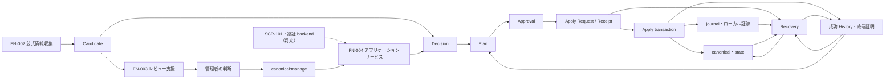
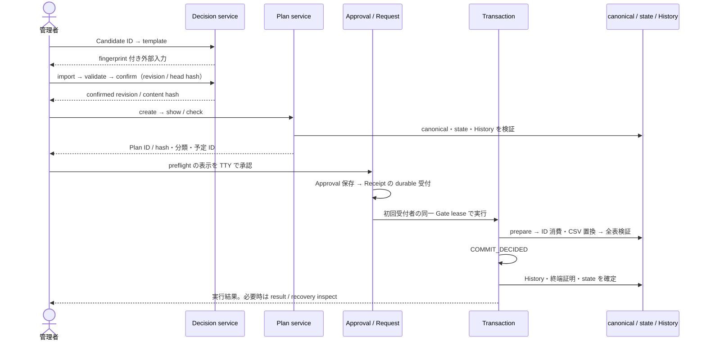

# FN-004 全体処理設計・APIリファレンス

調査基準は main の `cd46677e62c89814b99c751aedaf05515f9a73cd`。本文の実行契約はこの時点の実装に基づく。PR #109 の観測結果は第8章に記載する。

業務項目の入力、比較・計算、保存と応答は、[Decision 確認の内部処理設計](11-Decision確認処理.md) と [Plan 生成の内部処理設計](21-Plan生成処理.md) を参照。

## 第1章 機能概要・責務

FN-004 は、公式情報から収集した Candidate と管理者の根拠付き判断を受け取り、canonical CSV への追加計画、反映承認、実行、成功証跡、障害復旧を扱う。既存実体の再利用、新規実体・関係の追加、同一関係の `no_op` 分類を行う。入力は Candidate、Decision、現行 canonical・ID state・履歴、および実行者の明示承認。出力は Decision revision、Plan、Approval、Receipt、更新された CSV・state、成功 History・終端証明。初期化には別途、外部宣言と Git 監査が必要となる。

公式サイトの収集は FN-002 の `npm run collect:candidates`、レビュー支援の候補提示は FN-003 の `npm run prepare:reviews` が担当する。後者は `staging/song-reviews.json` を作成する。FN-004 の Decision は `song-candidates.json` の元観測と fingerprint を直接照合するため、FN-003 の実行やレビュー出力は必須でない。公開サイトの再生成や Git への公開は Apply 完了後の別工程。 [収集入口](../../../scripts/collect-candidates.js)・[レビュー準備](../../../src/prepare-reviews.js)・[Decision サービス](../../../src/fn004-decision-application.js)

## 第2章 全体アーキテクチャ

現在の操作入口はローカル CLI と信頼済み Node.js プロセス内サービス。SCR-101 と認証 backend は設計段階。共通 Gate で排他と読み取りの整合を確保する。CLI は構文解析、ローカル actor、表示、TTY 確認を担当し、サービスが OCC、ハッシュ、承認・受付、永続化を担当する。 [CLI adapter](../../../src/canonical-cli.js)・[サービス合成](../../../src/fn004-management-application.js)・[SCR-101](../screens/SCR-101-楽曲管理画面.md)

## 第3章 標準処理フロー

| 段階 | 入力 | 処理と出力 | 次へ進む条件 |
| --- | --- | --- | --- |
| 事前確認 | checkout、必要時は外部宣言 | `status`。未初期化時は `init --check` で Git 履歴と現行 CSV を監査し、監査 hash と明示確認で初期化 | READY / initialized。監査には完全な origin/main の到達履歴が必要 |
| Draft | Candidate ID、元観測、根拠、entity・relation 判断 | template → import。対象・fingerprint を固定し draft を論理追記 | 現在 head と現行 Candidate を特定できる |
| 確認 | Decision ID、revision、head hash | validate は検証結果、confirm は確認済みの新 revision。完全性・既存ID・競合を照合 | 有効 confirmed が得られ、別 Decision の適用済み範囲と衝突しない |
| 計画 | 有効 confirmed identity、canonical、state、History、Git 監査 | insert/reuse/no_op 等、予定 ID、target・precondition を計算し保存。show は原本、check は現在の評価 | APPLICABLE。hash と前提が一致 |
| 承認・受付 | 正確な Plan ID・hash と actor、事前に決めた request ID | TTY 確認後に独立 Approval を保存。Request を検証し Receipt に transaction/apply ID を固定 | 初回 durable 受付が成立し実行時再検証を通過。同 ID 同 payload 再送は照会 |
| 実行 | Receipt、Plan、元 snapshot、同一 lease | owner/intent/journal と復元材料を準備。ID を消費し、対象 CSV を順序付きで置換。全表検証後に COMMIT_DECIDED | durable な成功方針が成立。中断時は証跡に基づいて Recovery |
| 確定 | 成功方針、検証済み target | 成功 History・終端証跡・state の確定、cleanup、Gate 解放 | 通常運用再開は READY / initialized。履歴と diff を確認後、必要な検証・ビルド・Git 操作へ |

[Plan 実装](../../../src/fn004-plan-application.js)・[通常実行](../../../src/fn004-normal-apply.js)・[成功確定](../../../src/fn004-success-finalization.js)

## 第4章 API・CLI 一覧

CLI は `npm run canonical:manage -- <command> [--json]`。以下の実装欄はファイルと factory を示す略号を使用する。CLI の分岐は [runCanonicalCli](../../../src/canonical-cli.js)、引数定義は [parseCanonicalArguments](../../../src/canonical-cli-arguments.js) を参照。

| 略号 | 実装ファイル・factory |
| --- | --- |
| B | [fn004-bootstrap.js](../../../src/fn004-bootstrap.js) `createBootstrapService` |
| D | [fn004-decision-application.js](../../../src/fn004-decision-application.js) `createDecisionService` |
| P | [fn004-plan-application.js](../../../src/fn004-plan-application.js) `createApplyPlanService` |
| A | [fn004-approval-application.js](../../../src/fn004-approval-application.js) `createApprovalRequestService`。通常実行の合成は [fn004-apply-application.js](../../../src/fn004-apply-application.js) `createCanonicalApplyService` |
| M | [fn004-management-application.js](../../../src/fn004-management-application.js) `createCanonicalManagementService` |
| H | [fn004-history-runtime.js](../../../src/fn004-history-runtime.js) モジュール公開関数 |
| R | [fn004-repository.js](../../../src/fn004-repository.js) 読取ファサード |

「単独」は先行成果物や前提が揃えば別呼び出しとして利用できる意味。更新欄の「—」は業務ファイル更新なし。一時 Gate の取得・解放は含めない。エラー欄は代表例で、共通の I/O・Gate・state エラーは第7章を参照。CLI の引数誤りは `ARGUMENT_ERROR`。CLI はサービス DTO を表示用の形式へ射影する。 [CLI 出力実装](../../../src/canonical-cli-output.js)

### 4.1 公開 CLI 全操作

| 機能 | CLI | 実装メソッド | 入力 | 出力 | 前提 | 更新 | 代表エラー | 単独 |
| --- | --- | --- | --- | --- | --- | --- | --- | --- |
| ヘルプ | `help` / `--help` | runCanonicalCli | なし | 構文・操作一覧 | なし | — | ARGUMENT_ERROR | 可 |
| 状態 | `status` | B.inspectBootstrapStatus | checkout | status、readiness、診断 | Gate取得 | — | GATE_BUSY | 可 |
| 初期化監査 | `init --check` | B.checkBootstrap | `--external-declaration <file>` | 監査結果、audit hash | 外部宣言、Git監査 | — | BOOTSTRAP_INCOMPLETE | 可 |
| 初期化 | `init` | B.initializeBootstrap | `--external-declaration <file> --expect-audit-hash <hash>` | 初期化結果 | ローカルTTY確認、再監査 | Bootstrap、state、初期化証跡 | BOOTSTRAP_AUDIT_MISMATCH | 可 |
| 雛形 | `decision template` | D.createDecisionTemplate | `--candidate <id>` | 外部入力 JSON、mutation key | READY / initialized、Candidate 一意 | — | CANDIDATE_FINGERPRINT_MISMATCH | 可 |
| Draft 保存 | `decision import` | D.importDecisionDraft | `--input <file>` | revision、replayed | READY / initialized、妥当な外部入力と base | Decision | DECISION_INVALID、DECISION_HEAD_CONFLICT | 可 |
| Decision 表示 | `decision show <id>` | D.getDecision | Decision ID | head と選択 revision | READY / initialized、対象あり | — | PERSISTENCE_NOT_FOUND | 可 |
| 判断検証 | `decision validate <id>` | D.validateDecision | `--revision <n>` | valid、confirmable、診断 | READY / initialized、現在 head | — | DECISION_INCOMPLETE、DECISION_HEAD_CONFLICT | 可 |
| 判断確定 | `decision confirm <id>` | D.confirmDecisionHead | `--revision <n> --expect-head <hash>` | 確認済み新 revision | READY / initialized、現在 draft、完全性 | Decision | DECISION_INCOMPLETE、DECISION_HEAD_CONFLICT | 可 |
| Plan 作成 | `plan create` | M.createPlan → P.generateApplyPlan / saveApplyPlan | `--decision <id> --revision <n> --expect-decision-hash <hash>` | immutable Plan | READY / initialized、有効 confirmed identity | Plan | STALE_PLAN、PLAN_INTEGRITY_CONFLICT | 可 |
| Plan 表示 | `plan show <id>` | P.getApplyPlan | Plan ID | 保存 Plan | READY / initialized、対象あり | — | PERSISTENCE_NOT_FOUND | 可 |
| Plan 照合 | `plan check <id>` | P.checkApplyPlan | Plan ID | status、applicable、診断 | READY / initialized、対象あり | — | STALE_PLAN、ALREADY_APPLIED | 可 |
| 反映 | `apply` | M.preflight / applyPlan → A（通常実行合成） | `--plan <id> --expect-plan-hash <hash>` | Request・結果識別子、readiness、canonical effect | ローカルTTY確認、現在適用可能な Plan | Approval、Receipt、transaction 証跡、CSV、state、History、終端証明 | STALE_PLAN、RECOVERY_REQUIRED、PLAN_INTEGRITY_CONFLICT | 可 |
| 結果照会 | `result` | M.result → A.checkApplyRequest | `--request <id>` | 現在の結果、readiness、終端情報 | 元 Receipt、actor・binding 照合 | — | PERSISTENCE_NOT_FOUND、INTEGRITY_CONFLICT | 可 |
| 履歴表示 | `history show <id>` | M.history | apply ID | 検証済み成功 record | READY / initialized、state 証明 | — | HISTORY_CORRUPT、STATE_TRANSITION_PROOF_REQUIRED | 可 |
| 復旧観測 | `recovery inspect` | M.inspectRecovery | `--request <id>` | classification、observed state hash、allowed actions | 元 Receipt・Bootstrap、証拠と所有者の観測 | — | PERSISTENCE_NOT_FOUND、INTEGRITY_CONFLICT | 可 |
| 復旧実行 | `recovery run` | M.runRecovery | `--transaction <id> --expect-state-hash <hash> --action <action>` | 復旧結果と readiness | 最新の同 hash と唯一の許可 action、所有権の証明 | action に応じ CSV、state、History、終端・ローカル証跡 | RECOVERY_REQUIRED、INTEGRITY_CONFLICT | 可、inspect の観測が必要 |

### 4.2 プロセス内サービス

第4.1節のメソッドもプロセス内で呼べる。CLI が補う値には root、actor、外部 JSON の厳格読込、confirm の mutation key がある。B は `{root, external_declaration?, expected_audit_hash?, actor?}` を操作別に受ける。D のテンプレート・表示は ID、validate は `(id, revision, actor)`、import は `(document, actor)`、confirmHead は `{decision_id, revision, expected_head, actor, mutation_key}`。M は第4.1節の ID/hash を受け、createPlan は `{decision_id, revision, expected_decision_hash}`、runRecovery は `{transaction_id, expected_observed_state_hash, action}` を取る。Approval／Request は信頼済み `{actor, gate?}` を第2引数に使う。

| 機能 | API / 実装 | 入力 | 出力 | 前提 | 更新 | 代表エラー | 単独 |
| --- | --- | --- | --- | --- | --- | --- | --- |
| 判断編集・確定・取消し | D.saveDecisionDraft / confirmDecision / cancelDecision（同名 export も提供） | Decision mutation command。base revision/hash、source、content、cancellation、actor、key | revision、replayed | READY / initialized、OCC、操作別遷移 | Decision | DECISION_INVALID、DECISION_HEAD_CONFLICT、INTEGRITY_CONFLICT | 可 |
| 判断索引 | D.buildDecisionRegistry | factory の root | 有効 confirmed、claim 等の registry | READY / initialized、検証済み store | — | COMPETING_CONFIRMED_DECISION | 可 |
| 計画生成 | P.generateApplyPlan | `{decision_id}` | Plan オブジェクト | 有効 confirmed、snapshot、ID/履歴証明 | — | STALE_PLAN、RECOVERY_REQUIRED | 可 |
| 計画保存 | P.saveApplyPlan | Plan オブジェクト | 保存 Plan | 検証・再照合、APPLICABLE または BLOCKED | Plan | STALE_PLAN、PLAN_INTEGRITY_CONFLICT | 可 |
| 計画取得・検証 | P.getApplyPlan / checkApplyPlan | ID、check は Plan オブジェクトも可、任意の live gate | Plan / 現時点の評価 | READY / initialized、保存物・入力の完全性 | — | STALE_PLAN、PLAN_INTEGRITY_CONFLICT | 可 |
| 反映プレビュー | M.preflight | `(plan_id, expected_plan_hash)` | `{plan,check,display}` | 正確な hash、APPLICABLE | — | PLAN_INTEGRITY_CONFLICT、STALE_PLAN | 可 |
| 承認作成 | A.approveApplyPlan | `{approval_id,plan_id,plan_hash,intended_request_id}` | Approval 原本 | trusted actor、適用可能 Plan | Approval | APPROVAL_PLAN_MISMATCH、STALE_PLAN | 可、受付なし |
| 承認照会 | A.getApproval / checkApproval | Approval ID | 原本 / 現在の可否評価 | binding 検証、check は本人 | — | APPROVAL_PLAN_MISMATCH、APPROVAL_INVALIDATED | 可 |
| 承認失効 | A.invalidateApproval | `{event_id,approval_id,approval_hash,reason}` | 失効 event | 承認同定、Receipt の有無を証明 | 失効 event | INTEGRITY_CONFLICT | 可 |
| 失効照会 | A.getApprovalInvalidation / getApprovalInvalidations | event ID / context のみ | event / 全件 | 証拠一式を検証 | — | PERSISTENCE_NOT_FOUND、INTEGRITY_CONFLICT | 可 |
| 実行要求 | A.submitApplyRequest | closed v1 projection（repository、request、Decision、Plan、Approval、actor、purpose） | `{artifact,readiness,diagnostics,result}` | Approval と完全一致。新規の場合は現在適用可能 | Receipt。通常合成の初回のみ transaction も実行 | APPROVAL_INVALIDATED、APPROVAL_PLAN_MISMATCH、INTEGRITY_CONFLICT | 可、Approval が必要 |
| 受付原本 | A.getApplyRequest | Request ID | 検証済み保存原本 | Receipt と本人 | — | PERSISTENCE_NOT_FOUND、APPROVAL_PLAN_MISMATCH | 可 |
| 受付状態 | A.checkApplyRequest | Request ID | submit と同じ response DTO | Receipt と本人 | — | INTEGRITY_CONFLICT、APPROVAL_PLAN_MISMATCH | 可 |
| 履歴検証・照合 | H.readApplyHistory / lookupAppliedDecision | `{root,gate?}`、lookup は `decision,candidate_ids?,replaces?` も | 成功履歴検証結果 / 照合結果 | READY / initialized、success-only proof | — | STATE_TRANSITION_PROOF_REQUIRED、HISTORY_CORRUPT | 可 |
| canonical 読取 | R.readValidatedCanonicalSnapshot | root、options | 検証済み canonical snapshot | Gate と runtime guard、全表整合 | — | RECOVERY_REQUIRED、GATE_BUSY | 可 |

`createApprovalRequestService` のデフォルトは受付専用。通常 Apply は `createCanonicalApplyService` が executor を注入し、CLI は M を経由する。M.applyPlan は呼び出すたびに新しい承認・要求 ID を生成する。中断後に元要求を調べる入口は result / inspect である。 `executeAcceptedRequest`、`validateDecisionCanonicalContext`、`generatePlanFromInput`、Recovery classifier/executor、persistence、Gate primitive は内部処理。export は CLI 操作や外部クライアント用 API の追加を意味しない。 [Approval 実装](../../../src/fn004-approval-application.js)・[実行合成](../../../src/fn004-apply-application.js)

## 第5章 データ・状態管理

| データ | 正式パス | 更新主体・参照関係 | Git 方針 |
| --- | --- | --- | --- |
| Candidate | `staging/song-candidates.json` | FN-002 の元観測、Decision が source identity/fingerprint を固定 | 管理 |
| Review | `staging/song-reviews.json` | FN-003 の再生成可能な支援出力 | main に保存出力なし |
| Decision | `staging/decisions.json` | revision と content hash。論理追記しファイルは atomic replace | 管理 |
| Plan | `staging/apply-plans/<plan_id>.json` | Decision identity と canonical/ID/History 等の前提、操作、予定 ID を固定 | 原則非管理。実行・復旧中に必要な原本は保持 |
| Approval・失効 | `staging/apply-approvals/<approval_id>.json`、同 `invalidations/<event_id>.json` | Plan と intended_request_id に束縛する独立原本。失効も追記 | 管理 |
| canonical | `data/*.csv`（スキーマ定義の14表） | 楽曲データ正本。実行は対象行を追加し、全表の整合を検証 | 管理 |
| Bootstrap | `staging/fn004-bootstrap.json` | repository identity、初期監査、高水位の起点。state の公開後に完成マーカーを公開 | 管理 |
| state | `staging/fn004-state.json` | generation、high-water、割当、pending、History head/count を更新。失敗時の消費も証明する | 管理 |
| History | `staging/apply-history/<apply_id>.json` | 成功時の Decision/Plan/Approval/Request、適用済み範囲、実 ID と操作結果、連鎖の証跡。no-op の成功も記録 | 管理 |
| Terminal proof | `staging/transaction-proofs/<tx_id>.json` | 終端 state、成功・失敗時の効果、消費 ID の検証に使用 | 管理 |
| Receipt／completion | `staging/apply-requests/<request_id>.json`、同 `completions/<request_id>.json` | durable 受付と元 transaction/apply ID を固定。processing は補助。completion は終端証跡 | ローカル。Git ignore 対象 |
| journal・owner・intent・backup | `staging/transactions/<tx_id>/` | hash 連鎖、元／対象 bytes と進行証拠、復元材料。最新 cache は連鎖で検証 | ローカル。未解決の証拠を保持 |
| Gate・復旧所有権 | `staging/.fn004.lock`、`staging/.fn004-recovery.lock`、`staging/recovery-ownership/<tx_id>/` | 所有者と移譲・退役の証跡。Gate 候補や作業用 temp もローカル | ローカル |

「非管理」は運用上の方針。main の `.gitignore` は Receipt ディレクトリ、共通 lock、所定の temp、bootstrap transaction 等を対象とし、Plan、通常の transaction ディレクトリ、Recovery 所有権パスを一括除外していない。Git の差分は対象ファイルを明示して確認する。成功履歴の照合はローカル Receipt を前提としないが、元 Request の照会や Recovery の実行はその保存原本を必要とする。 [Git 方針](../system/レビュー準備・canonical反映の全体フロー.md#責務とgit管理)・[ignore](../../../.gitignore)・[実行時パス](../../../src/fn004-evidence-namespace.js)

## 第6章 状態遷移

### Decision revision

`draft → confirmed`、`draft/confirmed → cancelled`、`draft/confirmed/cancelled → draft` を新 revision で表す。各変更には現在 head の revision/hash が必要。新 draft の保存だけでは旧 confirmed が引き続き有効で、明示取消しまたは有効な replacement によって失効する。適用済みは成功 History の照合結果。 [Decision lifecycle](../../../src/fn004-decision-lifecycle.js)

### Plan・Approval・Apply

- Plan は immutable。保存後の check が `APPLICABLE`、`BLOCKED`、`STALE_PLAN`、`ALREADY_APPLIED` 等を評価する。
- Approval は immutable。使用済み・失効・stale は Request／History／失効 event と当時・現時点の binding から評価する。受付後の失効は受理済み要求を取り消さない。
- Request は Receipt で受付を記録し、成功結果は検証済み History を参照する。正常経路は `PREPARING → PREPARED → COMMITTING → COMMIT_DECIDED → HISTORY_COMMITTED → COMPLETED`。失敗終端には `ABORTED` または `ROLLING_BACK → ROLLED_BACK` がある。受付直後に journal が存在しない場合もある。COMMIT_DECIDED 後は成功確定側だけを扱う。rollback では canonical を復元し、消費済み ID を保持する。 [phase 定義](../../../src/fn004-evidence-types.js)・[通常実行](../../../src/fn004-normal-apply.js)

### Runtime・Recovery

通常利用の条件は `status=READY` と `readiness=initialized` の両方。初期化前は `BOOTSTRAP_REQUIRED`、片側だけの保存等は `BOOTSTRAP_INCOMPLETE`。未完了の要求や未証明の遷移は `recovery_required`、終端後の所定の片付けは `cleanup_required`、証拠破損等は `blocked`。Gate 競合は別レイヤーで検出する。Recovery 観測の classification／action はこの runtime readiness や journal phase とは別の値であり、`active`、不明、終端済みの観測では実行 action が空になり得る。 [runtime guard](../../../src/fn004-runtime-state.js)・[Recovery 判定](../../../src/fn004-recovery-classifier.js)

## 第7章 エラー・復旧

| コード | 段階・原因 | 対応 | CLI exit（単独要因） |
| --- | --- | --- | --- |
| DECISION_INCOMPLETE | 判断の根拠・必須参照が不足、同名実体に対する区別根拠不足、関係主キーや順序の競合等 | 表示された revision、Candidate と canonical の実データを確認し、判断を修正して新 draft を検証。既存収録行の再利用制約は第8章 | 3 |
| DECISION_HEAD_CONFLICT | draft 保存・検証・確定で現在 head と指定 revision/hash が不一致 | `decision show` で取り直し、人間が差分を確認して再判断 | 8 |
| STATE_HIGH_WATER_INVALID | namespace map 不正、証明済み使用上限未満、または起点の未証明変更 | Bootstrap、state、canonical、Git 監査と終端証明を照合。手編集による採番値調整や再初期化を避け、証拠不整合として停止 | 8 |
| GATE_BUSY | 正式 Gate が安定した有効な別所有者で占有 | 通常の作業が終わってから再確認。中断した実行は元 request を使って観測する | 5 |
| GATE_CORRUPT | 正式 Gate が不正形式・破損等 | lock、候補、所有者、関連証拠を保持して運用上の調査。無条件削除や強制取得の入口はない | 8 |
| RECOVERY_REQUIRED | 未完了 Receipt／transaction、pending、cleanup、または復旧指定の hash/action が古い・不適格 | 元 request を result / inspect。最新の観測 hash と唯一の許可 action があれば明示的に run。不明・破損で action が空なら停止 | 6 |
| STALE_PLAN | 現在の Decision、canonical、ID/履歴等の前提が変化 | 現在の判断に基づいて新 Plan を生成・確認し、新規承認 | 4 |
| APPROVAL_INVALIDATED / INTEGRITY_CONFLICT | 失効済み承認による新規受付、または exact binding・再送 payload・保存証拠に矛盾 | 失効時は現在の Plan と承認を確認。証拠矛盾は原本を保持して調査 | 3 / 8 |
| STATE_TRANSITION_PROOF_REQUIRED | 現在 state を正当化する証跡が揃わない | state、成功 History、終端証明と retained evidence の整合を確認 | 6 |

診断は例外のほか、status、Plan check、Request response 等にも現れる。CLI の exit はコマンド別 DTO と優先順位で決まる。例えば status の正常取得は運用可否と独立し、成功効果が証明済みで確定待ちなら 7、取消しは 10、abort/rollback の結果は 11。権限エラーは優先して 9。 [exit/DTO 実装](../../../src/canonical-cli-output.js)・[state 検証](../../../src/fn004-state.js)・[Gate 詳細](FN-004-Gate公開契約.md)

## 第8章 具体的なユースケース

各例は調査対象の契約を説明する。実行時に返された ID、revision、hash を後続操作へ渡す。

### 8.1 新規楽曲・新規作家

1. FN-002 の Candidate ID で `decision template`。外部入力で作品・楽曲・作家の local_ref、既存または新規のアーティスト／リリース、収録・クレジット関係、根拠を設定する。
2. `decision import → validate → confirm`。元観測 fingerprint と head を照合し、confirmed revision を得る。
3. `plan create → show/check`。新規実体および関係の insert、既存参照の reuse、予定 ID を照合する。
4. `apply` で exact Plan hash を人間が承認。Receipt／apply ID を取得し、`result → history show` で確定を確認する。期待結果は新規 CSV 行、ID state 進行、実 ID と根拠を参照できる成功 History。 [Plan 回帰](../../../test/fn004-apply-plan.test.js)・[CLI 統合回帰](../../../test/fn004-cli-e2e.test.js)

### 8.2 既存楽曲・既存作品の再利用

1. 未登録の収録位置を持つ Candidate を選び、template の楽曲・作品を既存 ID と根拠に束縛する。新しい収録関係を明示する。
2. `import → validate → confirm → plan create/check`。期待結果は work/song の reuse と新しい release_tracks の insert。既存 ID を再採番しない。
3. exact hash で `apply → result → history show`。新規収録行と成功証拠を確認する。収録位置が既存行と重なるケースには次節の制約がある。

### 8.3 J00018 に新規作家を追加する場合

| 観点 | main | PR #109 head（未マージ） |
| --- | --- | --- |
| Decision の既存収録行 | `validateDecisionCanonicalContext` は同一主キーを一律拒否。必須の既存収録参照を含む判断は `DECISION_INCOMPLETE` となり正式 Plan に進めない | 参照をすべて既存 ID に解決でき、Plan 共通の行テンプレートと全列比較で一致する場合は許可 |
| 対象・拒否条件 | Decision の関係検証と Plan の `no_op` 分類に到達条件の差がある | `release_tracks`、`song_artists`、`song_creators`、`song_performers` が対象。内容差、同じ収録位置への新規 song、Decision 内の主キー重複・順序衝突、別主キー間の順序衝突は拒否 |
| 期待結果 | この入力で `validate/confirm` まで。正式フローとしての Apply は不可 | 確認を通過し、同一関係は Plan で `no_op`。実際の追加は新規作家と新規作曲関係 |

PR #109 が確認した隔離ケースの入力は J00018・W00017・L00001 の reuse、Disc 2 / Track 2 の既存収録行と全列一致する判断、新規作曲者2名および関係2行。想定手順は `template → import → validate → confirm → plan create → plan check → apply → result → history show`。PR 本文の検証報告では existing track 1件は `no_op`、C00087・C00088 と作曲関係2行の計4件が insert。これらの ID は当該 checkout での結果で、実行時点の ID state に依存する。根拠は PR head `a4dc4337992c0951db1a766403005e2d0fc9eb03` の Decision 差分、正式 Decision 確認から Plan までの回帰、4関係の全列比較・重複・競合回帰、隔離検証の報告。マージ後は実際に採用された差分を再照合する。 [main の Decision](../../../src/fn004-decision-application.js)・[PR #109](https://github.com/YutoSuga/helloproject-song-data/pull/109)・[変更差分](https://github.com/YutoSuga/helloproject-song-data/pull/109/files)・[PR head の回帰](https://github.com/YutoSuga/helloproject-song-data/blob/a4dc4337992c0951db1a766403005e2d0fc9eb03/test/fn004-apply-plan.test.js)

### 8.4 Decision・Plan の確認で終了

`decision show → decision validate` で現在 head と診断を取得。計画が必要で head が draft なら、適合する判断を `decision confirm` で保存し、得た revision/hash で `plan create → plan show → plan check`。保存不要なら信頼済みサービスで `generateApplyPlan → checkApplyPlan` を使う。期待結果は固定 Plan またはメモリ上の計画と適用可否の診断。承認・受付・canonical 反映は別操作なので、この流れで終了できる。 [Plan 実装](../../../src/fn004-plan-application.js)

### 8.5 Apply 中断後の Recovery

1. 受付時の request ID で `result` を照会し、`recovery inspect --request <id>` から transaction、観測 hash、許可 action を得る。証拠と owner の終了を確認できる場合のみ実行候補が返る。
2. 唯一の action と同じ観測 hash を `recovery run` に渡す。Receipt のみ等で未変更を証明できる場合は `abort`、成功方針確定前の復元可能ケースは `rollback`。検証済み target からの成功確定は `finalize_success`。終端証明・completion の確定や残留物処理は `finish_terminal` / `cleanup`。個別の可否は classifier が判定する。
3. `result` と `status` を再確認する。成功時は `history show` で検証済み成功 record を確認。abort/rollback 時は未反映または復元と、その段階までに消費された ID の保持を確認。証拠が不明な場合は停止し原本を保全する。 [復旧判定](../../../src/fn004-recovery-classifier.js)・[CLI 中断回帰](../../../test/fn004-cli-crash.test.js)・[成功復旧回帰](../../../test/fn004-success-recovery.test.js)

## 第9章 制約・未対応機能

- 既存 canonical 行の内容更新・削除、メンバー新規登録・所属変更、動画、広範な訂正は v1 の正式 Apply 対象外。判断で unsupported request を表せるが confirmed では拒否する。既存関係と同一キーで内容が異なる場合は上書き不可。同一の Decision／適用済み範囲の再適用や、取り消しによる canonical の巻戻しも対象外。
- 管理 UI・認証 Web API、バッチ Apply、非TTY 承認、強制解除、任意 CSV patch、自動 commit/push/PR は未提供。SCR-102 は既存データ訂正等を検討する将来構想で、現行の API や復旧手段には含めない。 [操作ガイド](../../management/FN-004-canonical操作ガイド.md)・[ロードマップ](../../management/ロードマップ.md)

## 第10章 既存設計書との対応

| 既存設計書 | 担当範囲・本書の参照章 | 主な実装 |
| --- | --- | --- |
| [FN-004 Gate 公開契約](FN-004-Gate公開契約.md) | Gate 候補、公開・競合・解放、OS 境界（2、7） | `fn004-gate.js`、`fn004-gate-candidate.js`、`fn004-gate-publication.js` |
| [FN-004 初期化・ID状態](FN-004-初期化・ID状態.md) | 監査、genesis、高水位、state（3–7） | `fn004-bootstrap.js`、`fn004-state.js`、`fn004-git-audit.js` |
| [FN-004 判断モデル](FN-004-判断モデル.md) | fingerprint、判断 schema、OCC と registry（3–8） | `fn004-decision-core.js`、`fn004-decision-lifecycle.js`、`fn004-decision-application.js` |
| [FN-004 反映計画](FN-004-反映計画.md) | Plan schema、操作分類、予定 ID、check（3–8） | `fn004-plan-application.js`、`fn004-plan-generate.js`、`fn004-plan-validator.js` |
| [FN-004 承認・反映リクエスト](FN-004-承認・反映リクエスト.md) | binding、ハッシュ、失効、永続受付、応答（3–7） | `fn004-approval-schema.js`、`fn004-approval-application.js`、`fn004-approval-repository.js` |
| [FN-004 反映処理・復旧](FN-004-反映処理・復旧.md) | 全表検証、transaction、provenance、Recovery（3、5–9） | `fn004-normal-apply.js`、`fn004-durable-prepare.js`、`fn004-recovery-collection.js`、`fn004-recovery-classifier.js` |
| [FN-004 成功履歴・読取検証](FN-004-成功履歴・読取検証.md) | 成功 record、連鎖、適用済み検索、state 証明（3–8） | `fn004-history-runtime.js`、`fn004-history-verify.js`、`fn004-terminal-runtime.js` |
| [レビュー準備・canonical反映の全体フロー](../system/レビュー準備・canonical反映の全体フロー.md) | FN-002/FN-003、Git 管理方針（1–5） | `scripts/collect-candidates.js`、`src/prepare-reviews.js`、`.gitignore` |
| [共通サービス・CLI契約](../system/楽曲管理のアプリケーションサービス・CLI契約.md)／[操作ガイド](../../management/FN-004-canonical操作ガイド.md) | adapter、呼出構文、運用（2–9） | `canonical-cli.js`、`canonical-cli-arguments.js`、`canonical-cli-output.js`、`fn004-management-application.js` |
| [FN-002 楽曲候補収集](FN-002-楽曲候補収集.md)／[収集仕様](FN-002-楽曲候補収集仕様.md)／[FN-003 レビュー準備](FN-003-レビュー準備.md) | 元観測、派生レビュー（1–3） | `scripts/collect-candidates.js`、`scripts/prepare-reviews.js`、`src/prepare-reviews.js` |
| [SCR-101 楽曲管理画面](../screens/SCR-101-楽曲管理画面.md)／[データ仕様](../data/データ仕様.md) | 管理画面の構想と入力データ制約（1、2、5、9） | 現行 CLI とサービス、`canonical-schema.js`、`canonical-validator.js` |

### 10.1 実装との差異と読み替え

- 共通サービス契約表の `listReviews/getReview` に対応する FN-004 公開操作は存在しない。候補収集とレビュー準備は別 CLI。契約の `generateApplyPlan` は保存を含む説明だが、実装では生成と保存が独立し、CLI の `plan create` が両方を呼ぶ。 `executeTransaction`、`recoverTransaction`、`initializeState` 等の設計名はそのままの公開名ではない。現行の呼出名は第4章を参照。
- 共通サービス契約の CLI 設計例には初期化の必須 `--external-declaration` がない。現行 parser と操作ガイドでは check/初期化の両方で必須。
- 共通契約の Slice 5 部分には受付のみの説明が残る。通常 CLI は Slice 6E の実行を合成する。History も standalone の success-only 読取と CLI の composite proof 対応で条件が異なる。
- 全体フローの Git 方針と ignore の範囲の差は第5章、Decision 関係確認と Plan の分類の差は第8章を参照。

### 10.2 検証根拠

| 観点 | 既存回帰の参照 |
| --- | --- |
| 判断・Candidate/OCC・Plan の不変性 | [判断 lifecycle](../../../test/fn004-decision-lifecycle.test.js)・[Plan](../../../test/fn004-apply-plan.test.js) |
| 承認／失効・受付冪等性・応答 | [Approval](../../../test/fn004-approval-application.test.js)・[Request response](../../../test/fn004-request-response.test.js) |
| 公開 CLI・安全境界 | [CLI 契約](../../../test/fn004-cli-contract.test.js)・[E2E](../../../test/fn004-cli-e2e.test.js)・[CLI crash](../../../test/fn004-cli-crash.test.js) |
| Bootstrap、Gate、Recovery と History | [Bootstrap](../../../test/fn004-bootstrap.test.js)・[Gate 公開](../../../test/fn004-gate-publication.test.js)・[Recovery 判定](../../../test/fn004-recovery-decision.test.js)・[History readonly](../../../test/fn004-history-readonly.test.js) |

Slice 6A–6F、FA-M01、FA-L01 の計画・受入記録は、それぞれの時点の根拠として参照する。現行実行契約の判定は main のコードを優先する。 [履歴計画](../../history/plans/)・[受入・レビュー索引](../../history/reviews/README.md)
