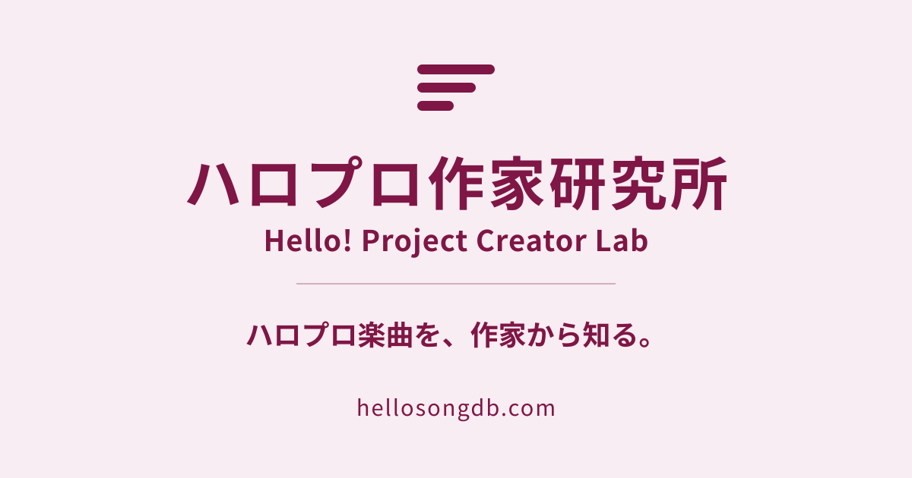

# サイト共通OGP・共有画像

1200×630pxのPNG。背景は `#f8edf2`、文字とランキングの横棒アイコンは `#7f1645`。中央揃えで、上から横棒アイコン、日本語名、英語名、区切り線、キャッチコピー、ドメインを配置する。日本語名を最も大きくし、四辺の余白を確保して縮小表示での判読性を確認する。

後続の実装PRでは、日本語フォントを明示した再生成可能な手順でSVGデザインからPNGを生成し、`site/assets/ogp.png` にコミット・pushする。実装時に日本語の字形・全4文言・PNGの正常なデコードと1200×630の寸法を確認する。GitHubのPR差分で画像を表示できることと、Pages artifactに含まれることを確かめ、公開後に正規ドメイン上の画像URLの200応答・Content-Type・共有タグを確認する。取り扱いに制約がある場合は、止まった工程・エラーを報告し、同じフォントでPNGを出力し、指定パスへ手動コミット・pushする手順を提示する。

作家・楽曲詳細は共通の静的OGPとブラウザの個別titleを使用する。個別OGP・個別画像・個別OGPのための静的生成は将来対応。

## faviconとApple Touch Icon

現行のHTMLは両用途に同じ `site/apple-touch-icon.png`（180×180）を使っている。現物はピンク・ボルドーの配色とH!Pの図形に加え、旧英語名「HELLO! PROJECT SONG DATABASE」を含む。ホーム画面アイコン等で旧称が残るため、後続PRで差し替えを提案する。配色を引き継ぎ、共有画像と同じ横棒を主役にした文字なしの正方形案を推奨。180pxのApple Touch Iconに加え、16px・32px相当でfaviconの識別性を確認し、採用は実装PRのレビューで判断する。設計PRでは現行画像を使用する。
