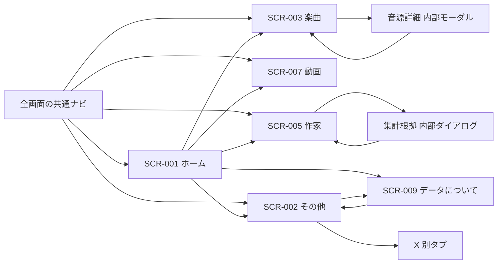

# 公開サイト画面一覧・遷移

公開サイトの画面と遷移。公開001〜099／管理101〜199の既存採番を維持。

| ID | 名称 | URL | 設計書 | モック |
| --- | --- | --- | --- | --- |
| SCR-001 | ホーム | `/` | [ホーム](public/SCR-001-ホーム.md) | [index.html](mockups/index.html) |
| SCR-003 | 楽曲一覧・検索 | `/songs/` | [楽曲一覧・検索](public/SCR-003-楽曲一覧・検索.md) | [songs.html](mockups/songs.html) |
| SCR-007 | 動画一覧 | `/videos/` | [動画一覧](public/SCR-007-動画一覧.md) | [videos.html](mockups/videos.html) |
| SCR-005 | 作家一覧・ランキング | `/creators/` | [作家一覧・ランキング](public/SCR-005-作家一覧・ランキング.md) | [creators.html](mockups/creators.html) |
| SCR-002 | その他・サイト情報 | `/more/` | [その他・サイト情報](public/SCR-002-その他・サイト情報.md) | [more.html](mockups/more.html) |
| SCR-009 | データについて | `/more/data/` | [データについて](public/SCR-009-データについて.md) | [data.html](mockups/data.html) |

## 画面遷移
全画面→共通ナビ→5ページ（クリック／タップ／Enter）。サイト名→ホーム。
ホーム→楽曲／作家／動画／その他は本文リンクでも遷移。ホーム→データについての更新履歴、その他→データについて、データについて→その他の連絡先は本文リンク。その他→Xは別タブ。
作家のカテゴリ・分析・候補・根拠ダイアログは同一ページ内切替。閉じると起点へ戻る。独立詳細画面へは遷移しない。楽曲名→work内の対象song詳細モーダル→×/Escapeで曲名に復帰。アーティスト欄は遷移なし。

SCR-004/006/008は将来候補。SCR-101は[既存管理画面設計](SCR-101-楽曲管理画面.md)を参照し今回変更しない。共通仕様は[公開サイト共通設計](公開サイト共通設計.md)。
