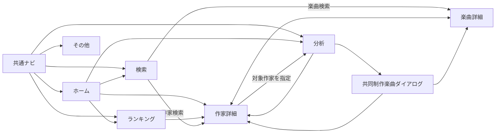

# 公開サイト画面一覧・遷移

ハロプロ作家研究所の再構成後の設計。現在のデプロイとの差は[現行調査](../../history/plans/公開サイト再構成.md)、共通のURL・復元仕様は[公開サイト共通設計](公開サイト共通設計.md)を参照。

| ID | 画面 | URL | 設計書 | モック |
| --- | --- | --- | --- | --- |
| SCR-001 | ホーム | `/` | [ホーム](public/SCR-001-ホーム.md) | [HTML](mockups/index.html) |
| SCR-005 | ランキング | `/ranking/` | [ランキング](public/SCR-005-作家一覧・ランキング.md) | [HTML](mockups/creators.html) |
| SCR-003 | 検索 | `/search/` | [検索](public/SCR-003-楽曲一覧・検索.md) | [HTML](mockups/songs.html) |
| SCR-009 | 分析 | `/analysis/` | [分析](public/SCR-009-分析.md) | [HTML](mockups/analysis.html) |
| SCR-002 | その他 | `/more/` | [その他](public/SCR-002-その他・サイト情報.md) | [HTML](mockups/more.html) |
| SCR-006 | 作家詳細 | `/creators/detail/` | [作家詳細](public/SCR-006-作家詳細.md) | [HTML](mockups/creator-detail.html) |
| SCR-004 | 楽曲詳細 | `/songs/detail/` | [楽曲詳細](public/SCR-004-楽曲詳細.md) | [HTML](mockups/song-detail.html) |
| SCR-007 | 動画一覧（休止） | `/videos/` | [動画一覧](public/SCR-007-動画一覧.md) | [休止案内](mockups/videos.html) |

詳細・根拠からは起点に戻れる。その他からの問い合わせ先は別タブ。SCR-008は動画詳細の将来候補。管理画面は[SCR-101](SCR-101-楽曲管理画面.md)。
