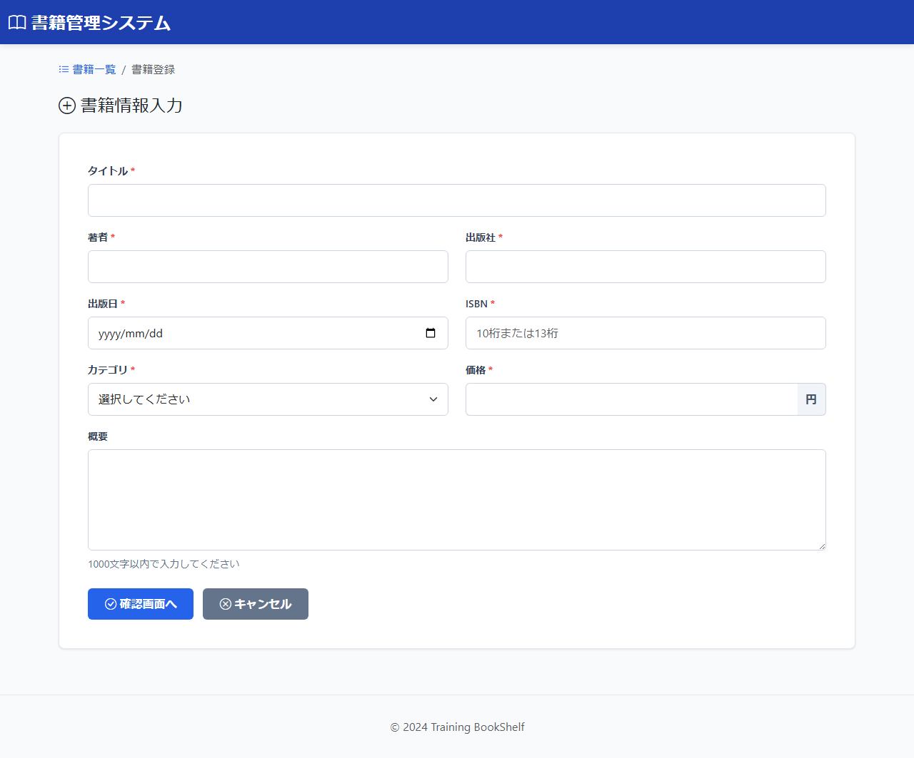

# BK03: 書籍登録入力画面
## training-bookshelf

---

## 1. 画面概要

### 画面ID
BK03

### 画面名
書籍登録入力画面

### 概要
新規書籍情報を入力する画面。入力後、確認画面へ遷移する。

### URL
`/book/create`

---

## 2. 画面項目定義

### 画面イメージ

| 項目名 | 項目ID | 型 | 必須 | 最大長 | 初期値 | バリデーション |
|--------|--------|-----|------|--------|--------|----------------|
| タイトル | title | text | ○ | 100 | - | 1文字以上100文字以内 |
| 著者 | author | text | ○ | 50 | - | 1文字以上50文字以内 |
| 出版社 | publisher | text | ○ | 50 | - | 1文字以上50文字以内 |
| 出版日 | publishedDate | date | ○ | - | - | YYYY-MM-DD形式、未来日付不可 |
| ISBN | isbn | text | ○ | 13 | - | 10桁または13桁の数字 |
| カテゴリ | category | select | ○ | - | - | プルダウン選択 |
| 価格 | price | number | ○ | - | - | 0以上の整数 |
| 概要 | description | textarea | - | 1000 | - | 1000文字以内 |
| 確認画面へボタン | btnConfirm | button | - | - | - | バリデーション実行後遷移 |
| キャンセルボタン | btnCancel | button | - | - | - | 一覧画面へ遷移 |

**カテゴリ選択肢:**
- 小説・文学（値: 1）
- ビジネス・経済（値: 2）
- IT・コンピュータ（値: 3）
- 科学・技術（値: 4）
- 歴史（値: 5）
- アート・デザイン（値: 6）
- 料理・グルメ（値: 7）
- 趣味・実用（値: 8）
- その他（値: 9）

**選択肢の取得元:** categoriesテーブルから全件取得（値 = category_id、表示 = category_name）

**プレースホルダー（入力ヒント）:**
- タイトル: `書籍のタイトルを入力してください`
- 著者: `著者名を入力してください`
- 出版社: `出版社名を入力してください`
- ISBN: `10桁または13桁の数字を入力してください`
- 価格: `価格を入力してください`
- 概要: `書籍の概要を入力してください(任意)`

---

## 3. 処理機能定義

### 3.1 初期表示処理

#### INPUT

| 項目名 | 取得元 | 備考 |
|--------|--------|------|
| タイトル | session | 確認画面から戻った場合のみ復元 |
| 著者 | session | 確認画面から戻った場合のみ復元 |
| 出版社 | session | 確認画面から戻った場合のみ復元 |
| 出版日 | session | 確認画面から戻った場合のみ復元 |
| ISBN | session | 確認画面から戻った場合のみ復元 |
| カテゴリ | session | 確認画面から戻った場合のみ復元 |
| 価格 | session | 確認画面から戻った場合のみ復元 |
| 概要 | session | 確認画面から戻った場合のみ復元 |

#### 処理内容

1. categoriesテーブルからカテゴリ選択肢を全件取得し、プルダウンに設定する
2. セッションに入力値がある場合（確認画面から戻ってきた場合）はそれを復元して表示する
3. セッションに入力値がない場合（初回表示）は空のフォームを表示する

#### OUTPUT

| 項目名 | セット先 | 備考 |
|--------|--------|------|
| カテゴリ選択肢 | DTO | 全カテゴリID・名称のリスト |
| タイトル | DTO | セッション値（確認画面から戻った場合のみ、なければ空） |
| 著者 | DTO | セッション値（確認画面から戻った場合のみ、なければ空） |
| 出版社 | DTO | セッション値（確認画面から戻った場合のみ、なければ空） |
| 出版日 | DTO | セッション値（確認画面から戻った場合のみ、なければ空） |
| ISBN | DTO | セッション値（確認画面から戻った場合のみ、なければ空） |
| カテゴリID | DTO | セッション値（確認画面から戻った場合のみ、なければ空） |
| 価格 | DTO | セッション値（確認画面から戻った場合のみ、なければ空） |
| 概要 | DTO | セッション値（確認画面から戻った場合のみ、なければ空） |

---

### 3.2 確認画面へボタン押下時

#### INPUT

| 項目名 | 取得元 | 備考 |
|--------|--------|------|
| タイトル | リクエスト | 必須 |
| 著者 | リクエスト | 必須 |
| 出版社 | リクエスト | 必須 |
| 出版日 | リクエスト | 必須。YYYY-MM-DD形式 |
| ISBN | リクエスト | 必須。10桁または13桁の数字 |
| カテゴリ | リクエスト | 必須 |
| 価格 | リクエスト | 必須。0以上の整数 |
| 概要 | リクエスト | 任意。1000文字以内 |

#### 処理内容

1. 入力値に対してバリデーションを実行する（必須・文字数・日付形式・未来日付・ISBN形式・数値チェック）
2. バリデーションエラーがある場合は入力画面に留まり、各項目の下にエラーメッセージを表示する（入力値を保持）
3. バリデーション正常の場合は入力値をセッションに保存して登録確認画面（BK04）へリダイレクトする

#### OUTPUT（バリデーションエラー時）

| 項目名 | セット先 | 備考 |
|--------|--------|------|
| 入力値（各項目） | DTO | 入力値保持のため（タイトル・著者・出版社・出版日・ISBN・カテゴリID・価格・概要） |
| カテゴリ選択肢 | DTO | 全カテゴリID・名称のリスト |
| エラーメッセージ | DTO | 各項目のバリデーションエラー内容 |

#### OUTPUT（正常時）

| 項目名 | セット先 | 備考 |
|--------|--------|------|
| タイトル | セッション | - |
| 著者 | セッション | - |
| 出版社 | セッション | - |
| 出版日 | セッション | - |
| ISBN | セッション | - |
| カテゴリID | セッション | - |
| 価格 | セッション | - |
| 概要 | セッション | - |

リダイレクト: BK04（`/book/create/confirm`）

---

### 3.3 キャンセルボタン押下時

#### INPUT

| 項目名 | 取得元 | 備考 |
|--------|--------|------|
| (なし) | - | - |

#### 処理内容

1. セッションに保存されている入力値を削除する
2. 一覧画面(BK01)へリダイレクトする

#### OUTPUT

セッション（入力値）を削除し、リダイレクト: BK01（`/book/list`）

---

## 4. バリデーション詳細

### 5.1 必須チェック
- タイトル、著者、出版社、出版日、ISBN、カテゴリ、価格

**エラーメッセージ:**
- 「{項目名}は必須です」

### 5.2 文字数チェック
- タイトル: 100文字以内
- 著者: 50文字以内
- 出版社: 50文字以内
- 概要: 1000文字以内

**エラーメッセージ:**
- 「{項目名}は{最大文字数}文字以内で入力してください」

### 5.3 日付形式チェック
- 出版日: YYYY-MM-DD形式

**エラーメッセージ:**
- 「出版日は正しい日付形式で入力してください」

### 5.4 未来日付チェック
- 出版日: 今日以前の日付

**エラーメッセージ:**
- 「出版日は未来日付を指定できません」

### 5.5 ISBN形式チェック
- ISBN: 10桁または13桁の数字

**エラーメッセージ:**
- 「ISBNは10桁または13桁の数字で入力してください」

### 5.6 数値チェック
- 価格: 0以上の整数

**エラーメッセージ:**
- 「価格は0以上で入力してください」

---

## 6. エラーハンドリング

### バリデーションエラー
- 入力画面に留まる
- エラーメッセージを各項目の下に赤字で表示
- 入力値を保持（再入力させる必要がないように）

---

## 7. 改訂履歴

| 版数 | 日付 | 改訂内容 | 作成者 |
|------|------|----------|--------|
| 1.0 | 2024-12-15 | 初版作成 | - |
