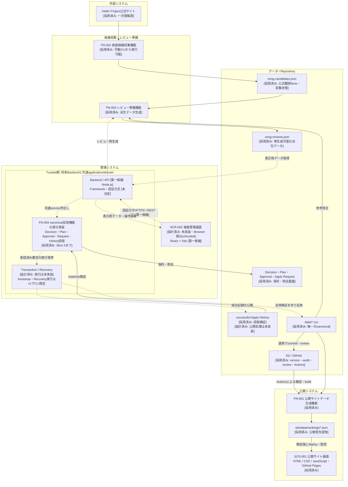

# システム構成

## 1. 目的

Hello! Projectの楽曲データについて、収集・人間判断・canonical反映・公開表示をつなぐ全体構成を示す。個別のschema、hash、排他、Transactionの詳細は既存の正式設計書を正とし、本書では複製・変更しない。

実装状況の確認基準は2026-10-31のmain（`1406114d099d9978e68b4184d32c2e746e94242c`）。FN-004 Slice 5は[PR #68](https://github.com/YutoSuga/helloproject-song-data/pull/68)で統合済み。本書はその時点の実装、正式設計、および今後の技術候補を区別する。[README](../README.md)、[機能ID体系](feature-ids.md)、[Roadmap](roadmap.md)には初期設計時・計画基準日時点の記述もあるため、FN-004全体の完成と部分実装を混同しない。

### 状態の読み方

| Status | 意味 |
| --- | --- |
| 採用済み | repositoryで実際に使用・実装されているもの |
| 設計済み | 正式設計はあるが、実装が全部または一部未完了のもの |
| 第一候補 | 人間が今後の方向性として合意している候補。導入・最終採用は未完了 |
| 未決定 | 後続の判断が必要なもの |

React + Vite、HTTPS / REST API、Node.js Backendは今回の構成方針における**第一候補**である。既存設計が未選定としているframework、認証、hosting、DB等を採用済みにするものではない。

## 2. 基本方針

- 公式情報の収集は自動化し、identityの確定・承認は人間が行う。候補の一致判定を人間判断へ自動昇格させない。
- 楽曲データの唯一の正本は`data/*.csv`。staging、生成JSON、将来のDBはcanonicalを置き換えない。
- stagingの観測facts、レビュー用派生データ、正式Decision、要求受付、成功結果を区別する。
- SCR-001 公開サイト画面とSCR-002 楽曲管理画面を分離する。
- Browserをuntrusted側、認証・認可と特権操作を扱うBackendをtrusted側として分離する。
- CLIと将来Backendは共通application/domain logicを利用し、FN-004を別実装しない。
- Git / GitHubをversion control、history、audit、review、公開deploymentに利用する。Git操作とcanonical Transactionは別境界とする。
- DBは現時点では不要。必要性が明らかになるまで導入を前提にしない。

## 3. 全体システム構成図

実線は現在の実装・運用上の経路、破線は未実装の接続・実行経路を示す。statusは各labelに記載する。図のartifactは保存モデルの存在も表し、productionに全種類のfileが生成済みという意味ではない。

BrowserからRepositoryへ直接到達する経路は設けない。図のBackend接続とTransaction経路は現在稼働していない。正式FN-004 CLIも未実装であり、図のCLI限定という記載は正式v1の権限境界を示す。

## 4. 現在のデータフロー

1. `npm run collect:candidates`がFN-002 楽曲候補収集機能を実行し、公式release情報を解析して`staging/song-candidates.json`を更新する。canonicalは参考照合のみで直接更新しない。
2. `npm run prepare:reviews`がFN-003 レビュー準備機能を実行する。candidate、canonical、および存在する場合のlegacy入力`staging/review-results.json`から、`staging/song-reviews.json`を再生成する。candidateやlegacy入力は更新しない。
3. 人間による判断は正式Decisionとして扱う。FN-003のsuggestion、仮ID、legacy review結果を正式Decisionへ自動変換しない。現在のDecision application libraryは利用可能だが、管理画面・正式管理CLIの入力adapterは未実装である。
4. FN-004 canonical反映機能の実装済みlibraryは、Decision、immutable Apply Plan、Approval / Invalidation、durable Apply Request受付・retry・照会、History readonly検証までを担う。**Request受付だけではcanonicalを変更しない。**
5. 正式設計上はこの先にTransaction、successful History公開、Recoveryが続くが、実行部分は未実装であり、現在の自動data flowとしては未接続である。
6. 現在のcanonicalを入力に、FN-001 公開サイトデータ生成機能が公開JSONを生成する。SCR-001 公開サイト画面はそのJSONを読み、GitHub Pages上で表示する。

収集→レビュー準備→人間判断→FN-004→canonical→公開生成→表示が全体の論理flowである。現在動いているCLIとlibrary、将来の管理入口を区別する。productionに`staging/song-reviews.json`が存在しなくても、FN-003の生成処理自体は実装済みである。

## 5. 管理システム構成

### Frontend / API

SCR-002 楽曲管理画面は**設計済み・未実装**。候補一覧、レビュー詳細、Decision編集、Apply Plan確認、人間のApproval、Apply Request、結果・Recovery必要状態・errorの表示を担う。[管理interface設計](design/楽曲管理のCLI・画面連携.md)の責務を引き継ぎ、詳細layout、routing、component構成、state management等は本書で決めない。

React + Viteは**第一候補**。component単位で複数の管理操作を整理しやすく、REST APIとの分離に適している。既存Web開発経験を活用し、別projectでも再利用できる構成設計の経験を蓄積しやすい。現在の公開frontendへReactを導入する決定ではない。

FrontendとBackendの境界は認証付きHTTPS / REST APIを**第一候補**とする。endpoint、HTTP method、wire schema、OpenAPI、versioning方式は後続設計で決める。

### Backend / 共通logic

将来のBackend runtimeはNode.jsを**第一候補**とする。既存JavaScript / Node.jsのFN-002〜FN-004との親和性があり、API adapterから既存application serviceを呼び出せる。Web frameworkは**未決定**で、Express / Fastify等の比較は後続taskとする。

Decision、Apply Plan、Approval、Apply Request、History readonlyの既存application/domain libraryを再利用する。Transaction / Recoveryは現時点では正式設計だけであり、後続実装を同じ境界へ接続する。Browser/API用の別FN-004実装や、adapterでのOCC・hash・idempotencyの再実装は行わない。

正式v1ではbootstrapとRecoveryの**実行はCLIのみ**とする。SCR-002は必要状態の表示・照会を担い、Web用Recovery実行APIを本書で追加しない。共通logicの再利用は、すべての特権操作をBrowserへ公開することを意味しない。

## 6. 公開システム構成

FN-001 公開サイトデータ生成機能は`src/canonical.js`でCSVを読み、`src/rankings.js`で集計し、`scripts/generate-rankings.js`から`site/data/rankings/*.json`へ出力する。現在の`npm run site:build`はこの生成処理を呼ぶ。

SCR-001 公開サイト画面は`site/index.html`、`site/styles.css`、`site/app.js`等のHTML / CSS / JavaScriptで実装済み。ブラウザが生成JSONを取得して表示し、CSVを直接集計・更新しない。現在の公開対象はJuice=Juiceである。

GitHub Actionsはtests、rankings validation、build、生成ranking dataの差分検査を行う。main向けの成功buildはGitHub Pagesへdeployし、PRではdeployしない。公開siteの配信機能は管理Backendでもcanonical書込入口でもない。詳細は[公開サイト設計](design/公開サイトのデータ生成・表示.md)を参照する。

## 7. 各コンポーネントの責務

| Feature / Component | Status / 実装範囲 | 責務・詳細 |
| --- | --- | --- |
| FN-001 公開サイトデータ生成機能 | 採用済み・実装済み | canonicalからランキング等のJSONを生成。[公開サイト設計](design/公開サイトのデータ生成・表示.md) |
| FN-002 楽曲候補収集機能 | 採用済み・実装済み | 公式情報の収集・解析・候補統合・保存。[候補収集設計](design/FN-002-楽曲候補収集.md)、[収集仕様](collection-spec.md) |
| FN-003 レビュー準備機能 | 採用済み・実装済み | 全candidateを照合し再生成可能なreviewを作る。[全体フローとFN-003仕様](design/レビュー準備・canonical反映の全体フロー.md) |
| FN-004 canonical反映機能 | 設計済み・段階実装中 | Slice 1〜5の基盤・Decision・Plan・History読取・Approval・Request受付は採用済み。Transaction / Recovery等は未実装 |
| SCR-001 公開サイト画面 | 採用済み・実装済み | 生成JSONの公開表示。管理操作を持たない |
| SCR-002 楽曲管理画面 | 設計済み・未実装 | 認証済み管理者向けの閲覧・判断・確認・結果表示。[管理interface設計](design/楽曲管理のCLI・画面連携.md) |
| JOB-001 楽曲候補定期収集ジョブ | 設計済みの呼出責務のみ・未実装 | 将来scheduled triggerからFN-002を呼ぶ。詳細・実行環境は未決定 |
| repository / persistence / common gate | 採用済み | path safety、strict読込、durable保存、協調reader / writerの排他。API adapterから迂回しない |

FN-004の実装は`src/fn004-decision-application.js`、`src/fn004-plan-application.js`、`src/fn004-approval-application.js`、`src/fn004-history-*.js`等にあり、testsは`test/fn004-*.test.js`で契約を検証する。formal contractの参照先は以下のとおり。

- [Decision / 判断モデル](design/FN-004-判断モデル.md)：人間判断、revision、OCC、candidate binding。
- [Apply Plan / 反映計画](design/FN-004-反映計画.md)：immutable計画、precondition、予定ID、stale検出。
- [Approval / Apply Request](design/FN-004-承認・反映リクエスト.md)：承認・失効、durable Receipt、idempotency、現在状態response。
- [Bootstrap / ID状態](design/FN-004-初期化・ID状態.md)：Git監査、外部宣言、repository lineage、genesis、ID state。
- [History / 成功履歴の読取検証](design/FN-004-成功履歴・読取検証.md)：authoritative successの検証、chain / proof、lookup。
- [Transaction / Recovery](design/FN-004-反映処理・復旧.md)：canonical commit、journal、失敗・復旧の正式設計。実行は未実装。

## 8. 技術スタック

| Layer | Technology | Status | Purpose / Notes |
| --- | --- | --- | --- |
| Public Frontend | HTML / CSS / JavaScript | 採用済み | SCR-001 公開サイト画面の静的表示 |
| Admin Frontend | React + Vite | 第一候補 | SCR-002 楽曲管理画面。未導入 |
| API Boundary | 認証付きHTTPS / REST API | 第一候補 | Browser / Backend分離。API詳細は未設計 |
| Existing Tooling / Domain | JavaScript / Node.js | 採用済み | 既存CLI・domain library・tests。CIはNode.js 20を使用 |
| Backend Runtime | Node.js | 第一候補 | 将来Web Backend。既存logicを再利用 |
| Backend Framework | 未選定（候補例：Express / Fastify） | 未決定 | framework比較は別task |
| Authentication / Authorization | 方式・provider・認可policy | 未決定 | 認証済み管理者・trusted actorという境界は設計済み |
| Canonical Storage | UTF-8 CSV、`data/*.csv` | 採用済み | 楽曲データの唯一の正本 |
| Staging | filesystem上のJSON artifacts | 採用済み | 下記の責務分離。Transaction関連は設計済み・未実装 |
| Version Control / Review | Git / GitHub | 採用済み | 履歴・audit・PR review。canonical Transactionとは別 |
| Public Hosting / CI | GitHub Pages / GitHub Actions | 採用済み | 公開siteの検証・build・deploy |
| Backend Hosting / Deployment | 未選定 | 未決定 | filesystem、排他、永続化の正式要件を満たす必要がある |
| Database | 現時点では不要（将来候補例：SQLite / PostgreSQL） | 未決定 | 必要性が出た場合だけ検討。canonicalはCSVを維持 |
| Scheduled Job | JOB-001からFN-002を定期起動 | 設計済みの呼出責務のみ | 未実装。実行環境・scheduleは未決定 |

### Architecture decision status一覧

- **採用済み**：CSV canonical、filesystem artifacts、既存Node.js tooling / library、静的公開frontend、Git / GitHub、GitHub Actions / Pages。
- **設計済み**：FN-004全体の安全契約（段階実装中）、SCR-002と共通application boundary、正式管理CLI、JOB-001の呼出責務。
- **第一候補**：React + Vite、認証付きHTTPS / REST API、Node.js Web Backend。
- **未決定**：Web framework、認証・認可の具体方式、Backend hosting / deployment、DBの要否・製品、JOB-001の実行環境・schedule。

## 9. セキュリティ境界

SCR-002は閲覧から認証済み管理者専用という正式設計を維持する。anonymous public writeを許さず、Apply操作は認証・認可を通過した管理者だけが要求できる。認証方式自体は未決定であり、OAuth、session、JWT等の採用を本書で決めない。

BrowserにGitHub token、Git credentials、server secrets、canonical write authority、FN-004 privileged Apply authorityを置かない。BrowserからGitHub APIを使ってcanonicalを直接commitする構成にしない。CSV、staging JSON、lock、journal、任意filesystem pathへの直接操作も公開しない。

将来Backendは認証・認可、trusted actorの設定、入力adapterを担当し、特権操作は共通service / repositoryへ委譲する。client申告のactorや「承認済み」という自己申告を信用しない。Git / GitHub credentialsが必要なserver-side運用はtrusted側で管理し、FN-004内の自動Git操作を新設する意味にはしない。現在のlibraryはtrusted in-process contextを受け取るものであり、既にHTTP認証を実装しているわけではない。

bootstrap / Recovery実行のv1 CLI限定、live lease・common gate、immutable artifacts、fail-closed検証をAPI導入で弱めない。正式Transactionは単一authoritative working treeと対応local filesystemを前提とするため、Backendの複数instance・共有filesystem・ephemeral storageを無検証で採用しない。hostingやDBを選ぶ際もこの制約を先に確認する。

## 10. データ管理方針

### Artifactごとの責務

以下は正式な保存先と管理方針であり、現在のproductionに全artifactが存在するという一覧ではない。詳細schema / hash / lifecycleは各設計書を参照する。

| Data / 保存先（staging配下） | 責務 | Status / Git方針 |
| --- | --- | --- |
| `song-candidates.json` | official source facts、candidate identity、collection state。canonical登録済みを意味しない | 採用済み / Git管理 |
| `song-reviews.json` | FN-003のderived review preparation。rebuildableで正式判断ではない | 採用済みの生成処理 / 楽曲・判断の正本にしない |
| `review-results.json` | 現行FN-003のlegacy過去判断入力。正式Decision / Historyへ自動昇格しない | 採用済みのreader / 正式v1台帳とは別 |
| `decisions.json` | human judgmentのimmutable revision。confirmed DecisionがFN-004正式入力 | 採用済み / Git管理 |
| `apply-plans/` | Decisionと現在入力から作るimmutable execution plan。derived / rebuildableでも参照中のPlanを勝手に破棄しない | 採用済み / 原則Git非管理 |
| `apply-approvals/` | exact Planへの人間承認。失効eventは`invalidations/`へ追記し原本を変更しない | 採用済み / Approval・InvalidationはGit管理 |
| `apply-requests/` | durable idempotent requestとimmutable Receipt。受付は成功反映の証明ではない | 採用済み / local実行情報としてGit非管理、未完了は保持 |
| `apply-history/` | successful Applyだけのauthoritative success record。失敗や進行中を成功扱いしない | 読取検証は採用済み、公開は設計済み・未実装 / Git管理 |
| `transactions/`、lock / temp / backup | canonical Transactionの実行・中断・復旧証跡。補助ログとは異なる | journal / 実行は設計済み・未実装、common gate等の基盤は採用済み / Git非管理、復旧前に削除しない |
| `fn004-bootstrap.json`、`fn004-state.json` | repository lineage、監査・genesis、ID high-waterとHistory / pending整合 | 採用済み / Git管理。将来のTransactionによる状態遷移は未実装 |

現productionにはcandidate、bootstrap、initial stateがあり、successful Historyは0件。Decision等の保存libraryが実装済みであることと、本番の判断・要求を作成済みであることは別である。

### canonical / generated data / Git

`data/*.csv`が唯一の楽曲正本で、詳細は[データ仕様](data-spec.md)に従う。FN-004 v1の自動反映範囲は既存参照と新規row追加に限定され、一般運用で可能な訂正のすべてを実行できるわけではない。

`site/data/rankings/*.json`はcanonicalから再生成する公開用データであり、CSVへ逆反映しない。現在は生成物もGit管理し、CIで再生成差分を検査する。将来DBを導入しても、検索用projection等とcanonicalの責務を分ける。

Gitはcanonical、Decision、Approval / Invalidation、successful History、bootstrap / state等のversion・監査履歴を保持し、GitHubはPR reviewと公開CI / deploymentを担う。FN-004の成功判定は検証済みHistory等の正式契約に従い、commit済みかどうかだけで判断しない。canonical Transaction成功とGit commit / pushは別境界であり、Gitやsite buildの失敗を理由に成功Applyをrollbackしない。自動Git操作はFN-004 v1対象外である。

## 11. 未決定事項

| 論点 | 現時点の境界 |
| --- | --- |
| React + Viteの最終採用・Frontend詳細 | 第一候補。routing、component、CSS、form / query library等は未選定 |
| API詳細 | HTTPS / REST APIが第一候補。endpoint、schema、versioningは未設計 |
| Backend framework | Express / Fastify等を後続taskで比較 |
| 認証・認可 | provider、session等の方式・policyは未決定。管理者境界は維持 |
| Backend hosting / deployment | provider、実行profile、永続化・排他・credentials管理を後続taskで判断 |
| DB | 現時点では不要。導入要否も含め未決定 |
| JOB-001 | 呼出先はFN-002。実行環境・schedule・運用詳細は未決定 |

これらは未実装の穴を推測で埋めるための暗黙設定ではない。本書はAPI詳細やTransaction / Recoveryの実装単位を決めない。

## 12. 将来拡張

JOB-001 楽曲候補定期収集ジョブは将来scheduled triggerからFN-002 楽曲候補収集機能を呼ぶ補助flowである。現時点でもFN-002は手動CLIで実行でき、JOB-001は初期SCR-002の必須componentではない。通知はJOB-001に含めない。

DBは検索、user管理、session、application state、performance、concurrency等の具体的な必要性が生じた場合に限って検討する。SQLite / PostgreSQLは将来候補の例であり、導入必須でも採用決定でもない。DB追加だけでFN-004のfilesystem排他・durability要件を代替したことにはしない。

REST境界は将来BackendをJava / Spring Boot等へ変更する余地を残す。ただし現在の第一候補はNode.jsであり、並行する第二のFN-004実装は作らない。変更する場合も正式domain契約・権限境界を維持する判断が必要となる。

Transaction / Recovery、正式CLI、Backend、SCR-002の実装は後続taskで進める。本書の作成では実装開始、Slice 6の分割・Planning、hosting / DBの選定を行わない。
